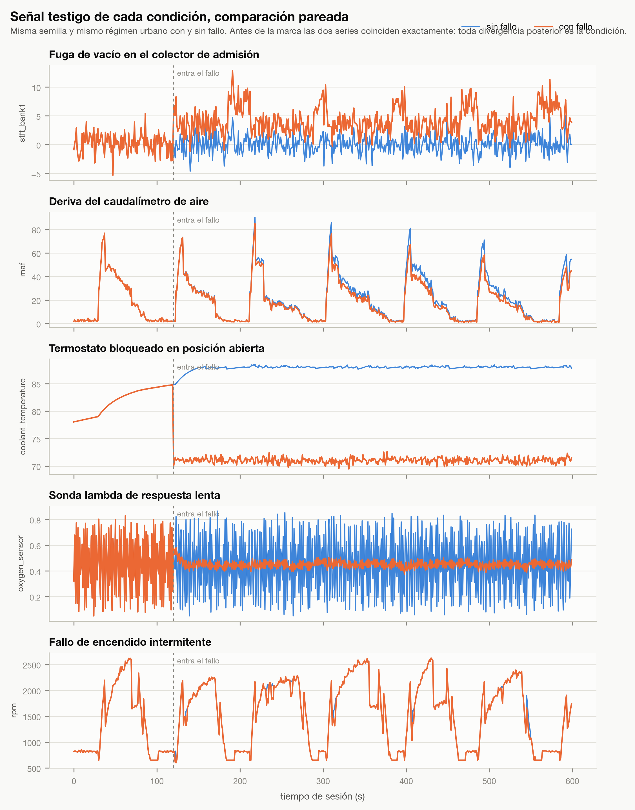
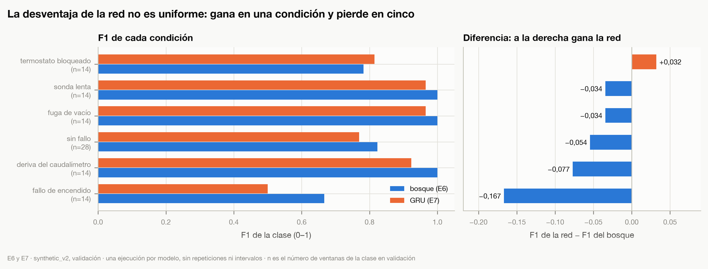

# Anexos

Los anexos no sustituyen a ningún apartado del cuerpo del trabajo. Reúnen el material que un lector
necesita para **verificar** lo que los capítulos 5 y 6 afirman, y que en el cuerpo ocuparía espacio
sin añadir argumento: la ficha del instrumento con que se generaron los datos, el detalle de
resultados que el texto cita de forma agregada, y el procedimiento para reejecutar el trabajo. Cada
anexo dice de qué capítulo depende y qué evidencia utiliza.

Tres cosas quedan fuera a propósito. Los protocolos experimentales completos —pre-registros,
enmiendas y políticas de evaluación— permanecen en el repositorio, porque lo que los hace útiles es
la fecha en que se escribió cada uno respecto de cuándo se midió, y llevarlos al documento los
congelaría en una versión. Los notebooks permanecen también en el repositorio, por la misma razón y
porque están pensados para ejecutarse. Y la evidencia principal de las cuatro subpreguntas se queda
en el capítulo 5: un anexo que la recogiera movería fuera del texto lo que ese texto argumenta.

---

# Anexo A · Arquitectura y datos experimentales

**Complementa:** capítulo 4, apartados de población y muestra e instrumentos; y el análisis
descriptivo del capítulo 5. **Evidencia que utiliza:** la ficha de calibración del generador contra
el manual de taller, las especificaciones de las señales y de las condiciones de fallo, y la
medición de reconstructibilidad de los tres conjuntos.

## A.1 · La arquitectura, en una línea por etapa

El sistema no es un modelo sino un recorrido de ocho etapas, y la decisión de diseño que este
trabajo evalúa es que estén separadas. La Figura 6.1 del capítulo 6 las dibuja; esta tabla dice qué
hace cada una y qué experimento la mide.

**Tabla A.1. Etapas del recorrido experimental y experimento que mide cada una.**

| Etapa | Qué hace | Lo mide |
|---|---|---|
| Telemetría | doce señales OBD-II a 1 Hz, una sesión como unidad de reparto | E2 |
| Análisis temporal | ventanas de 120 s con paso de 60 s, 139 descriptores por ventana | E4, E5 |
| Diagnóstico | bosque aleatorio sobre los descriptores; la red recurrente se evaluó y no se adoptó | E6, E7 |
| Confianza | calibración isotónica de la probabilidad del bosque | E6, calibrado en E15 |
| Atribución | valores de Shapley por permutación; produce las observaciones que las etapas siguientes consumen | E9 |
| Recuperación | búsqueda sobre el corpus del manual, guiada por los códigos de avería del diagnóstico | E10, E11, E12 |
| Verificación de suficiencia | comprobaciones deterministas sobre confianza, aplicabilidad, fuentes y cobertura de afirmaciones | E15, E18 |
| Decisión y redacción | explicar o abstenerse, con el motivo registrado; el modelo de lenguaje redacta y no decide | E13, E19 |

El rasgo que distingue a esta arquitectura de un sistema de generación aumentada por recuperación
convencional es que **la decisión de explicar no la toma el modelo de lenguaje**. La toma un
verificador determinista, y el modelo recibe esa decisión junto con la evidencia que la sostiene. El
capítulo 5 mide qué aporta esa separación en las ablaciones de E18, y el capítulo 6 declara lo que
esa medición **no** cubre: la separación misma no se ablacionó.

## A.2 · Las doce señales OBD-II

**Tabla A.2. Las doce señales OBD-II, con su unidad y su rango físico.**

| Señal | Unidad | Rango físico | Qué mide |
|---|---|---|---|
| `rpm` | rpm | 0 – 8 000 | régimen de giro del motor |
| `vehicle_speed` | km/h | 0 – 250 | velocidad del vehículo |
| `engine_load` | % | 0 – 100 | carga calculada del motor |
| `throttle_position` | % | 0 – 100 | posición de la mariposa |
| `coolant_temperature` | °C | −40 – 150 | temperatura del refrigerante |
| `intake_air_temperature` | °C | −40 – 120 | temperatura del aire de admisión |
| `maf` | g/s | 0 – 300 | caudal másico de aire |
| `map` | kPa | 0 – 255 | presión absoluta en el colector de admisión |
| `stft_bank1` | % | −100 – 100 | ajuste de combustible a corto plazo, banco 1 |
| `ltft_bank1` | % | −100 – 100 | ajuste de combustible a largo plazo, banco 1 |
| `oxygen_sensor` | V | 0 – 1,275 | tensión de la sonda lambda anterior al catalizador |
| `ignition_timing` | ° antes del PMS | −64 – 64 | avance del encendido |

*Fuente: elaboración propia a partir de `src/mecanico_ia_exp/obd/signals.py`.*

Los rangos no son decorativos: el generador recorta a ellos cada valor antes de escribirlo, y ese
recorte es la razón de que una reconstrucción con otro generador pueda coincidir en una fracción de
las muestras sin reproducir ninguna sesión.

## A.3 · Las cinco condiciones de fallo

Cada condición declara qué señales altera, con qué patrón temporal y qué debería observarse. Esa
declaración es anterior a cualquier medición y es con lo que se contrasta la atribución del modelo
en el capítulo 5.

**Tabla A.3. Las cinco condiciones de fallo, con sus señales declaradas y su patrón temporal.**

| Condición | Señales declaradas | Patrón temporal | Observación esperada |
|---|---|---|---|
| **F01** fuga de vacío en el colector | `stft_bank1`, `ltft_bank1`, `map`, `rpm` | persistente, acentuado en ralentí; el ajuste a largo plazo sube en rampa de unos 4 min | ajustes de combustible positivos, mayores a baja velocidad; presión de colector elevada en ralentí; régimen inestable |
| **F02** deriva del caudalímetro | `maf`, `stft_bank1`, `ltft_bank1` | deriva progresiva con rampa de unos 5 min | caudal por debajo de lo esperable para el régimen y la carga; ajustes positivos y crecientes |
| **F03** termostato bloqueado abierto | `coolant_temperature` | techo constante de temperatura; la firma es la **ausencia** de calentamiento | temperatura estancada por debajo de la de régimen pese a carga y tiempo suficientes |
| **F04** sonda lambda de respuesta lenta | `oxygen_sensor`, `stft_bank1` | persistente; amortiguación de la oscilación característica | menor amplitud y frecuencia de conmutación de la sonda; ajuste a corto plazo más ruidoso |
| **F05** fallo de encendido intermitente | `rpm`, `engine_load`, `stft_bank1`, `oxygen_sensor` | episódico: eventos de 1 a 3 s con tasa de aparición baja | caídas breves de régimen con salto de carga y desplazamiento de la sonda hacia mezcla rica |

*Fuente: elaboración propia a partir de `src/mecanico_ia_exp/obd/faults.py`.*

Parámetros con que se generaron: severidad 0,6 en la fuga; deriva del 18 % con rampa de 300 s en el
caudalímetro; techo de 71 °C en el termostato; suavizado de 0,82 en la sonda; y tasa del 2 % con
caída de 260 rpm en el fallo de encendido. El techo de 71 °C es el parámetro que la Figura 5.5 del
capítulo 5 usa como línea de referencia, y es declarado, no ajustado a los datos.

## A.4 · La calibración contra el manual de taller

Hasta el 1 de septiembre de 2026 las constantes del generador eran invenciones razonables sin
respaldo. Ese día se calibraron contra el manual del vehículo, y cada constante quedó con el fichero
del que sale y la cita literal que la respalda.

**Tabla A.4. Constantes del generador calibradas contra el manual de taller.**

| Constante | Valor anterior | Valor documentado | Cita del manual |
|---|---|---|---|
| Ralentí | 820 rpm | 640 – 740 rpm (Z6 con transmisión manual) | «Idle speed ATX Z6: 700 - 800 rpm MTX ZJ:690 - 790 rpm Z6:640 - 740 rpm» |
| Apertura del termostato | 88 °C | 82 °C (punto medio de 80 – 84) | «Thermostat Type Wax, bottom-bypass Opening temperature (°C) 80 - 84» |
| Caudal máximo del caudalímetro | ~90 g/s en transitorios | 59,5 g/s | «MAF sensor signal is more than 59.5 g/s» |
| Avance del encendido | sin respaldo | 9 – 11 ° antes del PMS | «Ignition timing (test mode on) (BTDC°) 9 - 11» |

*Fuente: elaboración propia a partir de `configs/calibracion_mazda3_bk.yaml`, extraído el 1 de septiembre de 2026 del manual de taller del vehículo de referencia.*

Calibrar contra el manual de un vehículo real **no convierte los datos en reales**. Siguen siendo
sintéticos; lo que cambia es que sus parámetros dejan de ser arbitrarios y pasan a estar
documentados. Esa distinción se mantiene en todo el trabajo.

## A.5 · Los tres conjuntos, y cuál se puede reconstruir

**Tabla A.5. Los tres conjuntos sintéticos y su reconstructibilidad medida.**

| Conjunto | Sesiones | Generado | Generador | ¿Reconstruible? | De él salen |
|---|---|---|---|---|---|
| `synthetic_v1` | 36 | 1-09-2026 | **anterior** a la calibración | **no**: 0 de 36 sesiones idénticas, diferencia máxima 1 973 rpm | E4, el análisis exploratorio |
| `synthetic_v2` | 72 | 13-09-2026 | calibrado | **sí**: 72 de 72 sesiones idénticas, y las cuatro huellas de los ficheros procesados coinciden bit a bit | E5, E6, E7, E9, E15, E18 y **la evaluación final E19** |
| `synthetic_v3` | 216 | 1-09-2026 | **anterior** a la calibración | **no**: 0 de 216 sesiones idénticas, diferencia máxima 1 983 rpm | la comparación de volumen de E6 y E7, y el conjunto de evaluación independiente del redactor, sin ejecutar |

*Fuente: elaboración propia. Medición del 13 de octubre de 2026 con `scripts/medir_reconstruccion_cruda.py`, que regenera cada sesión con el plan y la semilla declarados y la compara muestra a muestra con la almacenada. Registro en `configs/datos_no_reconstruibles.json`.*

Dos cosas conviene subrayar. La primera es que **las cifras publicadas del trabajo salen del
conjunto reconstruible**: el modelo de diagnóstico, la calibración, la atribución, la suficiencia,
las ablaciones y la evaluación final se miden sobre `synthetic_v2`. El sufijo `_v3` del fichero
`E19_evaluacion_final_v3.json` numera el **tercer intento de ejecución**, no la versión del conjunto.
La segunda es que la no reconstructibilidad de los otros dos es peligrosa precisamente porque no se
nota: su ventanado y su reparto sí reproducen bit a bit, porque dependen de identificadores e
instantes y no de valores, de modo que una reconstrucción ingenua pasaría las pruebas midiendo otras
señales. El guion de reconstrucción se niega con los dos.

## A.6 · La señal testigo de cada condición

Las tres tablas anteriores describen el instrumento; la Figura A.1 muestra lo que produce, señal a
señal y condición a condición.

**Figura A.1. Señal testigo de cada condición de fallo, comparada con la misma sesión sin fallo.**



*Fuente: elaboración propia. Experimento: E4, análisis exploratorio. Conjunto: `synthetic_v1`, sesiones pareadas. Protocolo: misma semilla, mismo régimen urbano y mismo perfil de conducción con y sin el fallo; antes del instante de entrada las dos series coinciden exactamente, de modo que toda divergencia posterior es la condición. Artefacto: `artifacts/figures/memoria/FIG-A-01_series_normal_vs_fallo.png`, copiado sin modificar de `artifacts/figures/FIG-E4-01_series_normal_vs_fallo.png`.*

La comparación es pareada a propósito: sin parear, la mayor parte de la diferencia visible sería la
forma de conducir y no la condición. En el panel de la fuga de vacío el ajuste de combustible se
separa con claridad; en el del termostato, la temperatura se estanca mientras la sana sigue subiendo;
en el de la sonda, la averiada es la de **menos** oscilación y no la de distinto nivel; y en el del
fallo de encendido las dos series son casi indistinguibles a simple vista, que es la observación que
anticipa su 7 de 14 en el capítulo 5.

**Esta figura no es reproducible desde cero, y conviene decirlo sin rodeos.** La rutina que la genera
no lee el conjunto: produce sus propias sesiones con el generador vigente en el momento de
ejecutarla, y el generador cambió el 1 de septiembre de 2026 al calibrarse contra el manual.
Ejecutarla hoy daría otra figura —el ralentí, por ejemplo, estaría en el rango documentado y no en
los 820 rpm que la figura muestra—. Se conserva como **artefacto histórico**, con la fecha y el
instrumento declarados, y no como una figura que un tercero pueda regenerar. Lo que ilustra —la
forma de cada fallo— sigue siendo válido; lo que no puede hacerse es tomar sus valores como los del
conjunto con que se entrenaron los modelos.

---

# Anexo B · Evidencia experimental complementaria

**Complementa:** capítulo 5, apartados de PI.1 y de contribución de cada componente. **Evidencia que
utiliza:** las tablas por clase de E6 y E7, el resumen de atribución de E9, el barrido de umbral de
E15b y el registro de aperturas del conjunto de prueba.

## B.1 · Qué estatuto tiene cada resultado

El trabajo acumula resultados de seis clases distintas, y confundirlos sería el error más fácil de
cometer al leerlo. Esta tabla fija cuál es cuál.

**Tabla B.1. Estatuto de cada resultado del trabajo.**

| Estatuto | Qué significa | Cuáles |
|---|---|---|
| **Canónico** | se mide sobre `synthetic_v2`, con registro vigente, y sostiene una cifra publicada | E5, E6, E7 y E9 sobre `synthetic_v2`; E12 tras la reejecución canónica; E15, E18 y **E19** |
| **Negativo** | la hipótesis pre-registrada no recibió apoyo, y se conserva | E7: el modelo temporal no supera a la línea base. La ablación A2 de E18, **inconclusa** por un defecto de la consulta y no por la ablación |
| **Afectado por contaminación** | el instrumento vio los casos sobre los que se le mide | el adaptador del modelo de lenguaje: 11 de los 17 casos de E13 proceden de ventanas que entraron en su ajuste. Sus cifras describen comportamiento sobre casos vistos, **no generalización** |
| **No canónico** | se midió y quedó sustituido o retirado | las cifras de E5, E6, E7 y E12 de los informes de fase anteriores a la reejecución; la conclusión «el límite era el volumen de datos», retirada el 12-10-2026 |
| **Exploratorio** | describe la muestra, no evalúa un sistema | E4, sobre `synthetic_v1`; la medición translingüe, sin registro de ejecución |
| **Pendiente** | diseñado y sin ejecutar | el reentrenamiento del adaptador, detenido por memoria insuficiente; la curva de volumen con subconjuntos anidados; el conjunto de evaluación independiente del redactor; el validador numérico |

*Fuente: elaboración propia a partir de `docs/experiment-index.md` y `docs/limitations.md`.*

Ningún resultado afectado por contaminación se utiliza en el cuerpo del trabajo como evidencia
independiente de generalización, y el capítulo 5 lo declara donde aparece.

## B.2 · El rendimiento por condición de los dos modelos

El capítulo 5 publica la exactitud y el F1 macro de los dos modelos de diagnóstico, y cita en prosa
la única condición en que la red recurrente gana. La Figura B.1 da el detalle por condición.

**Figura B.1. F1 por condición de los dos modelos de diagnóstico y diferencia entre ellos.**



*Fuente: elaboración propia. Experimentos: E6 y E7. Conjunto: `synthetic_v2`, partición de validación. Protocolo: una ejecución por modelo, semilla 20260901; n es el número de ventanas de la clase en validación. Artefacto: `artifacts/figures/memoria/FIG-B-01_f1_por_clase.png`, generado por `scripts/figuras_memoria.py` a partir de `artifacts/tables/E6_baseline_por_clase_synthetic_v2.csv` y `E7_temporal_por_clase_synthetic_v2.csv`.*

La Figura 5.3 del capítulo 5 muestra **adónde** van los errores de cada modelo; esta muestra
**cuánto** pesa cada condición en la diferencia agregada, que es lo que aquella no puede decir. La
red gana en una sola condición, el termostato, por 0,032, y pierde en las otras cinco, con el máximo
en el fallo de encendido, 0,167. La lectura es que la desventaja agregada de 0,056 en F1 macro no se
reparte: se concentra en la condición que menos señal deja. Las limitaciones son las del capítulo:
una ejecución por celda, sin repeticiones ni intervalos, y una diferencia de 0,032 sobre catorce
ventanas equivale a una ventana y media.

**Tabla B.2. F1 por condición de los dos modelos de diagnóstico.**

| Condición | F1 del bosque | F1 de la red | Diferencia | Ventanas |
|---|---|---|---|---|
| Sin fallo | 0,824 | 0,769 | −0,054 | 28 |
| Fuga de vacío | 1,000 | 0,966 | −0,034 | 14 |
| Deriva del caudalímetro | 1,000 | 0,923 | −0,077 | 14 |
| Termostato bloqueado | 0,783 | 0,815 | **+0,032** | 14 |
| Sonda lenta | 1,000 | 0,966 | −0,034 | 14 |
| Fallo de encendido | 0,667 | 0,500 | **−0,167** | 14 |

*Fuente: elaboración propia a partir de los registros `E6_baseline_synthetic_v2.json` y `E7_temporal_synthetic_v2.json`.*

## B.3 · Dónde se apoya el modelo, condición a condición

**Tabla B.3. Señales en que se apoya el modelo, por diagnóstico.**

| Diagnóstico | Casos | Confianza media | Señales principales | ¿La primera está declarada? |
|---|---|---|---|---|
| Sin fallo | 3 | 0,554 | `oxygen_sensor`, `rpm`, `ignition_timing`, `intake_air_temperature` | no aplica |
| Fuga de vacío | 3 | 0,722 | `ltft_bank1`, `stft_bank1`, `map`, `rpm` | sí |
| Deriva del caudalímetro | 3 | 0,656 | `ltft_bank1`, `stft_bank1`, `stft_bank1+ltft_bank1` | sí |

*Fuente: elaboración propia a partir de `artifacts/tables/E9_resumen_synthetic_v2.csv`. Tabla completa en el repositorio.*

La fila de la deriva del caudalímetro es la que más dice: entre sus señales principales **no aparece
el caudal de aire**, que es la señal averiada. El modelo detecta la deriva por cómo la centralita la
compensa. La Figura 5.8 del capítulo 5 lo muestra para las seis condiciones, y es la razón de que
las plantillas de afirmación del verificador no admitan «el caudalímetro deriva porque el caudal es
bajo».

## B.4 · El barrido del umbral de suficiencia

El umbral de confianza calibrada que el sistema usa, 0,79, salió de un barrido de cien puntos entre
0 y 1 sobre las 98 ventanas de validación, con la precisión por ventana como criterio. El criterio
original elegía el umbral más bajo con precisión igual o superior a 0,93, que daba 0,72; una
enmienda escrita **después** de ver ese resultado y **antes** de reejecutar las fases que dependen
del umbral exigió además que el objetivo se mantuviera en todo el tramo de cinco centésimas
siguiente, porque 0,72 lo cumplía por una sola ventana.

Esa secuencia importa más que el valor: el umbral no es un parámetro calibrado contra un objetivo
externo sino una **elección de política**, tomada con resultados preliminares a la vista, y así se
declara en el capítulo 5. Las diecisiete decisiones del conjunto anotado no cambian para ningún
umbral entre 0,60 y 0,90, de modo que el resultado publicado no depende de la elección entre 0,72 y
0,79.

*Fuente: `artifacts/tables/E15b_barrido_umbral.csv`, 100 puntos; criterio y enmienda en `docs/methodology/criterio-umbral.md` y `criterio-umbral-enmienda-01.md`.*

## B.5 · Las cinco aperturas del conjunto de prueba

El conjunto de prueba está cerrado en el código: pedirlo exige una autorización explícita y una razón
por escrito, que queda registrada. Se abrió **cinco veces**, y el trabajo distingue cinco niveles de
exposición, porque no todas consumen lo mismo.

**Tabla B.4. Los cinco niveles de apertura del conjunto de prueba.**

| Nivel | Qué es | Qué consume |
|---|---|---|
| 1 · apertura técnica | la partición se cargó, con razón por escrito | el registro, y nada más si no pasa de aquí |
| 2 · lectura de identificadores | se leyeron identificadores de sesión, recuentos o el reparto, sin ver señales ni etiquetas | casi nada en información, pero sí el argumento de no haber mirado |
| 3 · exposición de etiquetas | se vio qué fallo tenía cada ventana | la posibilidad de construir una hipótesis sin saber la respuesta |
| 4 · exposición de predicciones | se vio en qué acierta y en qué falla el modelo | lo que hace de la prueba una prueba: ya no se puede diseñar a ciegas |
| 5 · utilización de resultados | alguna decisión se tomó a la vista de lo que la prueba dijo | la independencia, sin remedio |

De las cinco aperturas, tres fueron intentos de la evaluación final —de los que el tercero es la
medición publicada—, una fue la comprobación pre-registrada de las ablaciones y una fue accidental y
solo leyó identificadores. En cuatro hubo exposición de etiquetas y de predicciones. Lo que sí se
sostiene, y se comprueba con una orden, es que **el instrumento no cambió entre la primera apertura
y la medición**: umbrales, casos elegibles, reglas de selección, política y código son los mismos.

*Fuente: `docs/methodology/registro-aperturas-test.md`, con fecha, motivo, configuración, alcance, exposición y métricas de cada una.*

---

# Anexo C · Reproducibilidad

**Complementa:** capítulo 6, objetivo específico 2. **Evidencia que utiliza:** el procedimiento
validado desde un clon limpio el 13 de octubre de 2026.

## C.1 · Qué hace falta

**Tabla C.1. Lo que hace falta para reejecutar el trabajo.**

| Elemento | Qué es |
|---|---|
| **Repositorio** | `mecanico-ia-exp`, entregado como copia del repositorio Git con su historia completa |
| **Commit de referencia** | el que encabeza la rama de entrega; su identificador aparece impreso en la primera celda de cada notebook ejecutado y en cada registro de experimento |
| **Entorno** | Python 3.11 y `uv`. No se usa `pip` suelto: el fichero de bloqueo fija todas las versiones |
| **Hardware** | cualquiera para los notebooks de demostración; una máquina con acelerador para reentrenar los modelos, que no hace falta para verificar |

## C.2 · Las cinco órdenes

```bash
git clone <repositorio> && cd mecanico-ia-exp
uv sync --extra nb --extra ml --extra rag --extra finetune --extra dev
bash scripts/reconstruir_datos.sh      # genera synthetic_v2 y COMPRUEBA sus cuatro huellas
uv run pytest                          # 902 sin reconstruir; 919 después
uv run jupyter lab notebooks/
```

La tercera orden es la que importa: no se limita a generar el conjunto, sino que contrasta sus cuatro
huellas contra las que el manifiesto de la evaluación final congeló **antes** de abrir el conjunto de
prueba. Si alguna difiere, falla. Un conjunto reconstruido que no coincide con el congelado no sirve
para nada, y es mejor saberlo ahí que al leer una cifra.

## C.3 · Los notebooks

Siete notebooks acompañan a la entrega. Seis se ejecutan con lo que trae un clon; el séptimo
necesita el conjunto reconstruido.

**Tabla C.2. Los siete notebooks entregados, con su modalidad.**

| Notebook | Qué contiene | Modalidad |
|---|---|---|
| `00_introduccion` | el recorrido experimental y cómo leer los demás | demostración |
| `01_exploracion_obd` | las señales, las condiciones y el estudio de ventana | reproducción |
| `02_comparacion_modelos` | bosque frente a red recurrente, calibración y el confusor de volumen | reanálisis |
| `03_analisis_e19` | la evaluación final, sus denominadores y sus intervalos | reanálisis |
| `04_explicabilidad` | la atribución y su contraste con las señales declaradas | reanálisis |
| `05_suficiencia_y_abstencion` | el verificador, las ablaciones y la contaminación del adaptador | reanálisis |
| `06_expresion_del_fallo` | expresión efectiva del fallo, ventana a ventana | reproducción |

Cada uno declara en su cabecera la modalidad, el conjunto, el commit y qué se puede y qué no se
puede concluir de lo que muestra. Sus versiones **HTML**, con las figuras y las tablas dentro, están
en `docs/notebooks/html/` y se abren sin instalar nada ni ejecutar una celda: son la vía de lectura
para quien quiera revisar sin reproducir.

## C.4 · Los guiones de verificación

**Tabla C.3. Guiones de verificación del repositorio.**

| Guion | Qué comprueba |
|---|---|
| `scripts/estado_pruebas.py` | las tres categorías de prueba y qué falta para ejecutar cada una |
| `scripts/verificar_reconstruccion.py` | las huellas del conjunto reconstruido contra las congeladas |
| `scripts/medir_reconstruccion_cruda.py` | si el generador publicado reproduce las señales de un conjunto, sesión a sesión |
| `scripts/figuras_memoria.py` | regenera cualquier figura de la memoria desde los registros congelados |
| `scripts/auditar_cifras_redactadas.py` | si el texto redactado por el modelo de lenguaje contiene cifras que el verificador no produjo |
| `scripts/reproduce_main_results.sh` | la cadena de resultados principales |

## C.5 · Lo que no se puede reproducir, y por qué

**Tabla C.4. Lo que no se puede reproducir, y por qué.**

| Qué | Por qué | Consecuencia |
|---|---|---|
| `synthetic_v1` y `synthetic_v3` | son anteriores a la calibración del generador; el publicado produce otras señales | las figuras y tablas de E4 y la comparación de volumen no son reproducibles por un tercero. El guion se niega a regenerarlos |
| El corpus documental | 3 055 ficheros de un manual con licencia, que no se redistribuye | las fases que lo necesitan no se pueden ejecutar sin conseguirlo |
| El índice documental | se construye del corpus | las pruebas que lo requieren quedan declaradas |
| Los pesos del adaptador | no se distribuyen | la redacción con el modelo de lenguaje no se puede reejecutar |

Las pruebas que dependen de cualquiera de estos recursos **se detienen diciendo qué falta y con qué
orden se obtiene**, en lugar de pasar en silencio. Es una decisión de diseño: una prueba que se salta
sin avisar es peor que una que falla.

*Fuente: `docs/reproducir-desde-cero.md`, validado desde un clon limpio el 13 de octubre de 2026, con todos los pasos en verde; y `configs/datos_no_reconstruibles.json`.*
