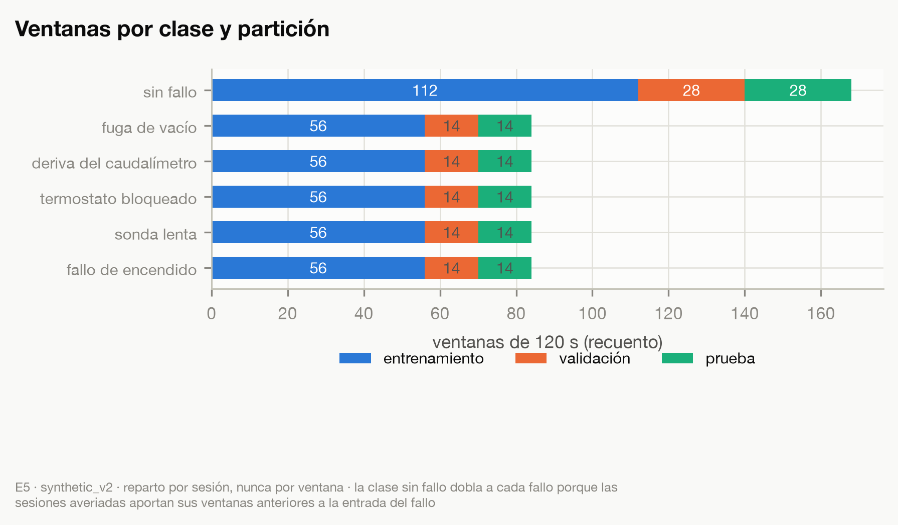
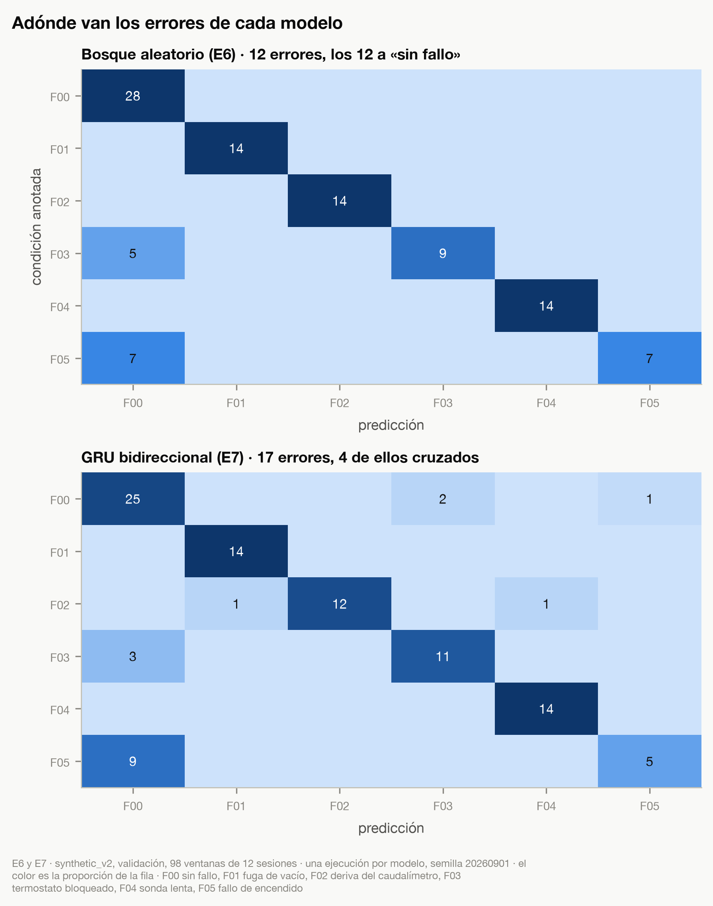
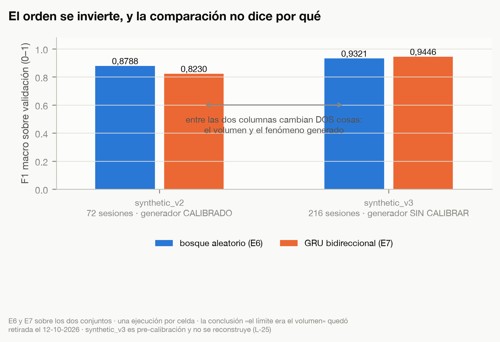
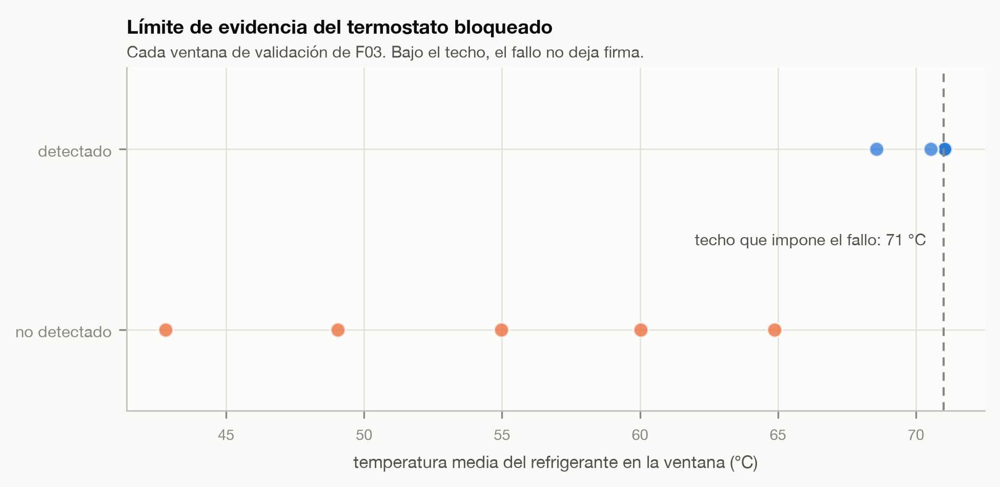
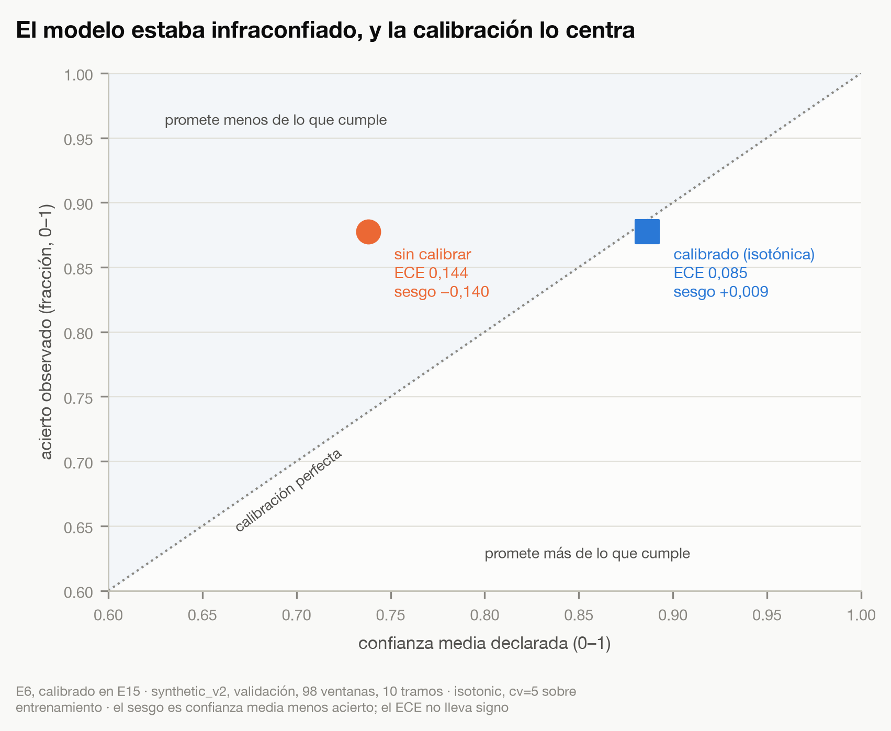
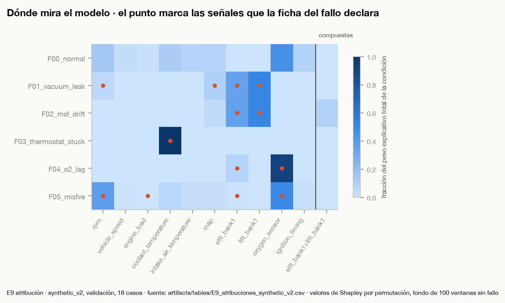
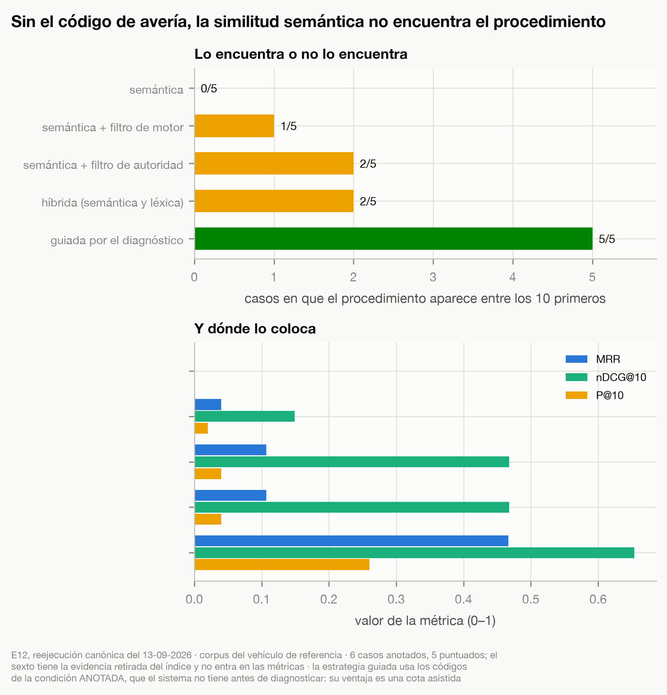
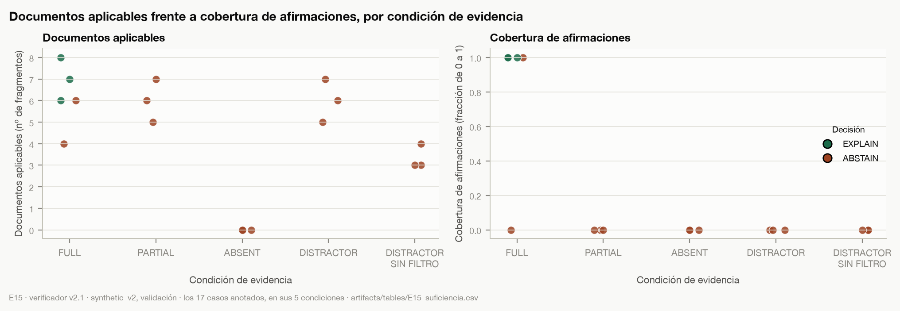
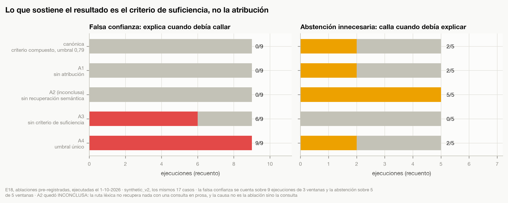
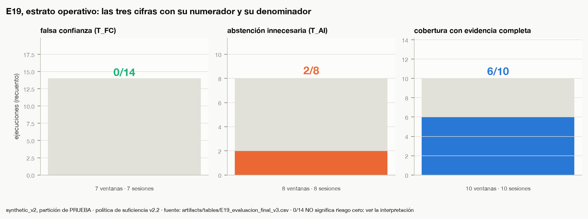

# Capítulo 5: Presentación de análisis, resultados y discusión
Todos los resultados de este capítulo proceden del vehículo de referencia definido en el capítulo 4, un Mazda 3 BK de 2007 con motor Z6, y de su corpus documental. No se han evaluado otros vehículos ni otras generaciones.

Las cifras de este capítulo proceden de la partición de **validación** de la muestra sintética descrita en el capítulo 4. El conjunto de prueba **se abrió cinco veces**: tres intentos de la evaluación final, de los que el tercero es la medición publicada; una comprobación pre-registrada de las ablaciones; y una apertura accidental que solo leyó identificadores de sesión. En cuatro de las cinco hubo exposición de etiquetas y de predicciones. El registro completo, con los cinco niveles de exposición que se distinguen, está en `docs/methodology/registro-aperturas-test.md`. Lo que sí se sostiene, y se comprueba con un comando, es que el instrumento no cambió entre la primera apertura y la medición: umbrales, casos elegibles, reglas de selección, política y código son los mismos. La procedencia del dato es sintética, y su validez externa se discute en el capítulo 6. Cada tabla cita el registro de ejecución del que sale. **La evaluación final sobre el conjunto de prueba se ejecutó el 12 de octubre de 2026** y su informe es `docs/experiments/E19_evaluacion_final.md`: falsa confianza 0 de 14 ejecuciones y abstención innecesaria 2 de 8, con un conjunto anotado sellado antes de abrir la partición; con esos denominadores el intervalo de incertidumbre es amplio, y se publica con sus cifras en el apartado dedicado a esa evaluación. **La demostración integrada sigue pendiente.**

> **Corrección del 13 de octubre de 2026.** El texto de este párrafo decía antes: «el conjunto de prueba permanece cerrado y no se ha consultado […] Son resultados parciales: la evaluación final sobre el conjunto de prueba y la demostración integrada quedan pendientes». Las dos afirmaciones eran falsas en el momento de revisarlas: el conjunto se había abierto cinco veces y la evaluación final ya se había ejecutado. La propuesta de corrección, con su evidencia, está en `docs/audits/correccion-cap5-cap6-paso-a.md` (`F-1` y `F-6`).

Las cifras de recuperación, de suficiencia y del modelo de lenguaje proceden de una reejecución realizada el 13 y el 14 de septiembre de 2026. El 4 de septiembre se detectó que el índice documental contenía dos representaciones vectoriales por fragmento y que ninguna búsqueda declaraba en cuál buscaba, de modo que la procedencia de cada fragmento recuperado era indeterminada. Se corrigió el defecto, se fijó por escrito y antes de medir qué se compararía y cómo se interpretaría, y se repitieron la recuperación, la suficiencia en sus dos modos, la generación del conjunto de ajuste y la redacción con el modelo de lenguaje con el mismo modelo, umbral y política. Ninguna de las diecisiete decisiones cambió; los conjuntos de fragmentos recuperados cambiaron en diez de los diecisiete casos, siempre por adición. Con arreglo al criterio fijado de antemano, ese resultado se lee como ausencia de efecto detectable con este instrumento, no como confirmación del criterio de suficiencia. Los registros anteriores se conservan como históricos; las filas de nueve casos de la Tabla 5.7 y el escenario adverso proceden de ellos, del 4 de septiembre.

Tres rasgos del diseño condicionan todo lo que sigue sobre el agente. El criterio de suficiencia, su umbral, las anotaciones de los casos, la ampliación del conjunto y el adaptador del modelo de lenguaje se fijaron o revisaron sobre los mismos diecisiete casos con que se evalúan, de modo que las cifras del agente son de desarrollo y no de evaluación. Los diecisiete casos se construyeron sobre ventanas de validación que el modelo clasifica correctamente, de modo que las tasas de decisión describen el comportamiento del agente cuando el diagnóstico de partida es acertado y deben leerse como cota superior. Y la estrategia de recuperación con mejores valores acota su búsqueda con los códigos de avería que documentan la condición **anotada**, información que el sistema no tiene antes de diagnosticar; su ventaja mide una cota asistida por esa anotación y no una capacidad de recuperación comparable con las demás.

## Análisis descriptivo de la muestra
La muestra sintética consta de 72 sesiones de 600 segundos, 12 por condición, muestreadas a 1 Hz; ventanadas a 120 segundos con solape producen 392 ventanas de entrenamiento y 98 de validación, con 139 descriptores por ventana. Las 98 ventanas de validación proceden de 12 sesiones, dos por condición: cada condición de fallo aporta 14 ventanas, y las 28 sin fallo incluyen las anteriores a la entrada del fallo en las sesiones con fallo. El reparto es por sesión, y por eso ninguna ventana de validación comparte sesión con una de entrenamiento.

El reparto de la muestra entre las tres particiones condiciona qué se puede medir y con cuántas
observaciones, y conviene verlo antes de leer ninguna métrica. La Figura 5.1 lo presenta por clase y
por partición, con los recuentos que produjo la fase de ventanado y reparto.

**Figura 5.1. Ventanas por clase y partición de la muestra sintética.**

*Fuente: elaboración propia. Experimento: E5, ventanado y reparto. Conjunto: `synthetic_v2`, 72 sesiones de 600 s a 1 Hz. Protocolo: ventana de 120 s con paso de 60 s; el reparto es por sesión, nunca por ventana. Artefactos: `artifacts/figures/memoria/FIG-5-01_particiones.png`, generado por `scripts/figuras_memoria.py` a partir de `data/processed/synthetic_v2_meta.parquet`; tabla `artifacts/tables/E5_reparto.csv`.*

La figura muestra un reparto equilibrado entre las cinco condiciones de fallo y una clase sin fallo
que dobla a cada una de ellas. El desequilibrio no es un artefacto del muestreo: las sesiones
averiadas aportan sus ventanas anteriores a la entrada del fallo, y esas ventanas son ventanas sin
fallo. De ahí que la clase mayoritaria alcance el 28,6 % de la validación, que es exactamente la
exactitud de la referencia mínima de la Tabla 5.1. Lo que la figura no dice es nada sobre la
dificultad de cada clase: dos condiciones con el mismo número de ventanas pueden ser muy desiguales
en lo que de ellas se puede aprender, y los apartados siguientes muestran que lo son. Su aportación
a la pregunta de investigación es indirecta y previa: fija la unidad de observación —la ventana, con
la sesión como unidad de reparto— sobre la que se cuentan después todas las decisiones del agente.

El análisis exploratorio previo al modelado dejó dos hechos que condicionan la lectura de todo lo demás. El primero es que los cinco fallos no se separan de la condición sin fallo por la misma vía, y que dos de ellos no lo hacen por el nivel de ninguna señal. La fuga de vacío y la deriva del caudalímetro se separan por el nivel del ajuste de combustible a corto plazo, con delta de Cliff 1,00 las dos; el termostato bloqueado, por el nivel de la temperatura del refrigerante, con −0,75, y es el fallo con la firma más clara en medias, 69,2 °C frente a 81,4 de la condición sin fallo. La sonda lambda de respuesta lenta, en cambio, **no se separa por el nivel sino por la dispersión**: su oscilación se amortigua casi por completo, de una desviación típica de 0,250 a 0,033, y la delta de Cliff es −1,00 en dispersión frente a +0,29 en nivel. Y el fallo de encendido queda diluido en el agregado porque sus episodios alteran el 5,7 % de los instantes de la sesión: la caída media de régimen durante ellos es de −218 revoluciones, pero la desviación típica de la variación de régimen de toda la sesión sube solo de 115,4 a 117,1. Su mejor separación medida sobre bloques de 60 segundos, +0,58 en el nivel de la sonda lambda, es el efecto grande más débil de los cinco. Las cifras de este párrafo proceden del análisis exploratorio, que se hizo sobre `synthetic_v1` y con el generador anterior a su calibración contra el manual de taller: describen el mismo mecanismo que el conjunto de modelado representa, pero no el mismo instrumento, y no son reproducibles con el generador publicado. Lo que el modelo aprende después se mide sobre `synthetic_v2`, que sí lo es. El segundo hecho es de otra naturaleza y afecta solo al termostato, que tiene un límite físico de detección: mientras el motor no habría superado por sí mismo la temperatura a la que el fallo lo limita, la señal averiada es idéntica a la sana. En esas ventanas la respuesta correcta del sistema es abstenerse, y no hubo que fabricar el caso.

> **Corrección del 13 de octubre de 2026.** Este párrafo decía antes: «dos de los cinco fallos no son visibles en las medias de las señales: **el fallo de encendido y el termostato bloqueado abierto** solo se distinguen de la condición sin fallo por la dispersión o por la evolución temporal, no por el nivel». El termostato es, de los cinco, el **más** visible en la media de una señal, y el fallo que faltaba nombrar es la sonda lambda de respuesta lenta. El párrafo mezclaba además dos cosas: no tener firma en el nivel, y tener un techo físico por debajo del cual no se deja firma de ninguna clase, que es lo propio del termostato y es la frase siguiente. Ninguna cifra del capítulo cambia. La propuesta, con su evidencia, está en `docs/audits/propuesta-figuras-cap5-cap6.md` (`F-8`).

Ese contraste entre fallos admite una medida, y es la que la fase exploratoria produjo antes de
entrenar nada: para cada señal y cada condición, cuánto se separa de la condición sin fallo, medido
por separado sobre el nivel del bloque y sobre su dispersión. Importa porque determina qué puede
aprender el modelo y, más adelante, qué puede afirmar legítimamente la explicación. La Figura 5.2
recoge esa medida para las doce señales y las cinco condiciones.

**Figura 5.2. Separabilidad de cada señal por condición, en nivel y en dispersión.**

*Fuente: elaboración propia. Experimento: E4, análisis exploratorio. Conjunto: `synthetic_v1`, bloques de 60 s. Protocolo: delta de Cliff frente a la condición sin fallo, calculada por separado sobre la media del bloque y sobre su desviación; se etiquetan las celdas con efecto grande, |delta| ≥ 0,474. Artefactos: `artifacts/figures/memoria/FIG-5-02_separabilidad.png`, generado por `scripts/figuras_memoria.py` a partir de `artifacts/tables/E4_separabilidad.csv`.*

Las cinco mejores celdas, una por condición, reparten los fallos en dos grupos. Tres se separan por
el nivel y con efecto máximo o casi: la fuga de vacío y la deriva del caudalímetro en el ajuste de
combustible a corto plazo, y el termostato en la temperatura del refrigerante. La sonda lenta
alcanza el efecto máximo **solo por la dispersión**, con un nivel de +0,29 que no distingue nada. Y
el fallo de encendido tiene un único efecto grande, +0,58, el más débil de los cinco. La lectura que
esto permite es que los descriptores por ventana no podían limitarse a medias sin dejar dos
condiciones indetectables por construcción, y así se decidió en el capítulo 4. Sus limitaciones son
dos y conviene no olvidarlas: la delta de Cliff ordena pero no explica, de modo que un efecto grande
en una señal no implica que el modelo la use —el apartado de atribución muestra un caso en que no la
usa—, y la medición es sobre bloques de 60 segundos y no sobre las ventanas de 120 con que se
entrena. Para la pregunta de investigación, esta figura delimita por anticipado qué afirmaciones
sobre una señal pueden tener soporte observacional y cuáles no.

El estudio de ventana del capítulo 4 fijó 120 segundos como longitud en la que los descriptores separables coinciden con los mecanismos físicos declarados para cada fallo. En particular, la deriva del caudalímetro no se detecta en el caudal medido sino en las correcciones de combustible con que la centralita la compensa. Esto condiciona qué puede afirmar legítimamente el agente: «el caudalímetro deriva porque el caudal es bajo» sería falso, y las plantillas de afirmación del verificador no permiten formularlo.

## Resultados obtenidos
Los resultados se presentan por subpregunta, PI.1 a PI.4, siguen con la medición del modelo de lenguaje y terminan con la contribución de cada componente. Primero lo observado; después su interpretación.

### PI.1 · Diagnóstico, calibración y atribución
**Tabla 5.1. Rendimiento del modelo de diagnóstico sobre la partición de validación.**

| Modelo | Exactitud | F1 macro | Registro |
| --- | --- | --- | --- |
| Referencia mínima (clase mayoritaria) | 0,286 | 0,074 | `E6_baseline_synthetic_v2.json` |
| Bosque aleatorio, 139 descriptores | 0,878 | 0,879 | `E6_baseline_synthetic_v2.json` |
| GRU bidireccional sobre secuencias | 0,827 | 0,823 | `E7_temporal_synthetic_v2.json` |

*Fuente: elaboración propia.*

Los informes de fase del modelo de diagnóstico daban cifras ligeramente distintas (F1 0,876 para el bosque; exactitud 0,806 y F1 0,822 para la red recurrente), procedentes de una ejecución anterior que una ejecución posterior sustituyó sin que el informe se actualizara. La tabla cita los registros vigentes; el del bosque se reprodujo bit a bit el 14 de septiembre de 2026 con la misma semilla. Ninguno de los dos registros incluye el identificador de la versión del código, que solo se hizo obligatorio a partir del 4 de septiembre.

El modelo temporal no supera al tabular. Por clase acierta dos ventanas más en el termostato bloqueado, 11 de 14 frente a 9 de 14, sobre dos sesiones y una sola semilla; con este volumen de datos la complejidad añadida no está justificada en agregado, y se conserva el bosque como modelo de diagnóstico. Con un conjunto tres veces mayor, generado como análisis de sensibilidad y no adoptado, el orden se invierte por un margen de 0,012 en F1 macro en una sola ejecución. **Esa comparación no permite atribuir la diferencia al volumen de datos**, porque entre los dos conjuntos cambian dos cosas a la vez: el número de sesiones y el generador que las produjo, que en el conjunto mayor es anterior a su calibración contra el manual de taller. Con dos puntos de medida y dos variables en movimiento, el experimento no tiene grados de libertad para separarlas, y la desventaja del modelo temporal queda sin causa establecida. Todos los errores del bosque van a la condición «sin fallo»: el modelo no produce diagnósticos cruzados, lo que para un sistema que va a explicar es la dirección de error menos dañina.

Las cifras agregadas de la Tabla 5.1 no dicen adónde van los errores de cada modelo, y para un
sistema que después va a explicar su diagnóstico esa es la pregunta que más pesa: equivocarse hacia
«sin fallo» produce una omisión, y equivocarse hacia otro fallo produce una explicación bien
construida sobre una avería que no existe. La Figura 5.3 pone las dos matrices de confusión juntas.

**Figura 5.3. Matrices de confusión del bosque aleatorio y de la red recurrente sobre la partición de validación.**

*Fuente: elaboración propia. Experimentos: E6 y E7. Conjunto: `synthetic_v2`, partición de validación, 98 ventanas de 12 sesiones. Protocolo: una ejecución por modelo, semilla 20260901, reparto por sesión. Artefactos: `artifacts/figures/memoria/FIG-5-03_confusiones.png`, generado por `scripts/figuras_memoria.py` a partir de `artifacts/tables/E6_baseline_confusion_synthetic_v2.csv` y `E7_temporal_confusion_synthetic_v2.csv`; registros `E6_baseline_synthetic_v2.json` y `E7_temporal_synthetic_v2.json`.*

Los doce errores del bosque —cinco del termostato y siete del fallo de encendido— caen todos en la
columna de la condición sin fallo, y ninguna celda fuera de la diagonal y de esa columna está
ocupada: el modelo no confunde un fallo con otro. La red recurrente comete diecisiete errores y
cuatro de ellos sí son cruzados: dos ventanas sin fallo que diagnostica como termostato, una como
fallo de encendido, y dos derivas de caudalímetro que atribuye a la fuga de vacío y a la sonda. La
interpretación que esto permite va más allá de los cinco puntos de F1 macro que separan a los dos
modelos: la dirección del error del bosque es la menos dañina para el recorrido completo, porque una
omisión llega al verificador como ausencia de diagnóstico y un diagnóstico cruzado llegaría como una
hipótesis falsa con evidencia documental coherente detrás. La limitación es la de siempre en este
capítulo: una ejecución por modelo, una semilla y 98 ventanas procedentes de doce sesiones, de modo
que el patrón se describe y no se estima. Para la pregunta de investigación, la figura acota el
escenario en que se mide el agente: su diagnóstico de partida falla por omisión, no por sustitución,
y el comportamiento ante una sustitución solo se ha observado en el escenario adverso que se
describe más adelante.

La comparación entre los dos conjuntos merece verse, porque es un resultado negativo que estuvo a
punto de leerse como positivo. La Figura 5.4 la presenta tal como es, con las dos variables que se
mueven a la vez nombradas en el propio eje.

**Figura 5.4. Comparación del rendimiento de los dos modelos entre los dos conjuntos sintéticos.**

*Fuente: elaboración propia. Experimentos: E6 y E7 sobre los dos conjuntos. Conjuntos: `synthetic_v2`, 72 sesiones con el generador calibrado contra el manual, y `synthetic_v3`, 216 sesiones con el generador anterior a esa calibración. Protocolo: una ejecución por celda, semilla 20260901. Artefactos: `artifacts/figures/memoria/FIG-5-04_confusor_volumen.png`, generado por `scripts/figuras_memoria.py` a partir de los registros `E6_baseline_synthetic_v{2,3}.json` y `E7_temporal_synthetic_v{2,3}.json`.*

El orden se invierte entre las dos columnas, y la figura no permite decir por qué. Lo que la
inversión sí permite afirmar es algo más modesto y más útil: que la conclusión publicada en su día
—que el límite del modelo temporal era el volumen de datos— no se sostiene sobre esta comparación, y
quedó retirada. Dos limitaciones acompañan a la figura y conviene declararlas juntas: es una sola
ejecución por celda, sin repeticiones ni intervalos, y el conjunto mayor no es reconstruible con el
generador publicado, de modo que un tercero no puede rehacer la mitad derecha de la figura. La forma
de responder la pregunta sin el confusor está diseñada —una curva de volumen dentro de un solo
conjunto, con subconjuntos anidados y validación fija— y no se ha ejecutado. Respecto de la pregunta
de investigación, la aportación de esta figura es metodológica antes que empírica: muestra el tipo
de error que el trabajo intenta detectar en su propio proceso, que es tomar por evidencia de una
causa una diferencia que dos causas explican igual de bien.

El fallo de encendido se detecta en 7 de las 14 ventanas de validación de esa condición, procedentes de dos sesiones. El resultado estaba anticipado por escrito antes de medirlo, con su motivo cuantificado en el estudio de ventana, y no se aumentó la severidad del fallo para mejorar la cifra.

Las dos condiciones que el modelo falla, el termostato y el fallo de encendido, lo hacen por razones
distintas, y la del termostato es comprobable sobre la propia muestra. El fallo impone un techo a la
temperatura del refrigerante; mientras el motor no habría superado ese techo por sí mismo, el fallo
no impone nada y la señal del motor averiado es idéntica a la del sano. La Figura 5.5 cruza, para
cada una de las catorce ventanas de esa condición, si el modelo acertó con la temperatura media de
la ventana.

**Figura 5.5. Acierto del modelo en cada ventana del termostato bloqueado, frente a la temperatura media del refrigerante.**

*Fuente: elaboración propia. Experimento: E6. Conjunto: `synthetic_v2`, las 14 ventanas de validación de la condición de termostato bloqueado. Protocolo: cada punto es una ventana; la línea marca el techo de temperatura que el fallo impone, 71 °C, que es un parámetro declarado del generador y no una línea ajustada a los datos. Artefacto: `artifacts/figures/memoria/FIG-5-05_limite_evidencia_termostato.png`, copiado sin modificar de `artifacts/figures/FIG-E6-02_limite_evidencia_f03.png`, que produjo la propia ejecución de E6.*

Las cinco ventanas no detectadas están todas por debajo del techo, entre 43 y 65 °C, y las nueve
detectadas se agrupan contra él. La interpretación es que ese error no es una limitación del modelo
sino un límite de la evidencia disponible: en esas ventanas no hay nada que distinga a un motor
averiado de uno sano, y ninguna arquitectura los separaría. Es, además, el caso en que abstenerse es
la respuesta correcta, y no hubo que fabricarlo. La figura tiene dos limitaciones: son catorce
ventanas de dos sesiones, y lo que muestra es una coincidencia entre estar por debajo del techo y no
ser detectada; lo que sostiene la causa no es la figura sino que el techo sea un parámetro declarado
del generador. Para la pregunta de investigación es la evidencia más directa de que existen
situaciones en las que la respuesta correcta de un sistema de diagnóstico es callar, y de que esas
situaciones pueden identificarse por anticipado y no solo lamentarse después.

La distinción que esa figura hace visible en un fallo admite una medida general, y conviene
introducirla porque cambia cómo se leen los falsos negativos de todo el capítulo. Que una ventana
lleve la etiqueta de una condición significa que la sesión tenía el fallo activo en ese tramo; no
significa que el fallo haya dejado alteración observable en ninguna de sus señales. Las dos cosas se
pueden separar generando, con la misma semilla, la trayectoria con fallo y la trayectoria sin él, y
contando qué fracción de las muestras de la ventana difiere por encima del suelo de ruido de cada
señal. La Figura 5.6 presenta esa fracción ventana a ventana.

**Figura 5.6. Expresión efectiva del fallo en cada ventana de validación, y ventanas que el modelo de diagnóstico falla.**

*Fuente: elaboración propia. Experimento: E6, medición añadida el 12 de octubre de 2026. Conjunto: `synthetic_v2`, partición de validación, las 70 ventanas etiquetadas con alguna condición de fallo. Protocolo: para cada ventana se compara la trayectoria con fallo con la trayectoria sin fallo de la misma semilla, y una muestra cuenta como alterada si la diferencia supera el 10 % de la desviación típica de esa señal. Artefacto: `artifacts/figures/memoria/FIG-5-06_expresion_del_fallo.png`, producido por el notebook `06_expresion_del_fallo.ipynb`.*

La fuga de vacío, la deriva del caudalímetro y la sonda lenta expresan el fallo en la totalidad de
sus ventanas. El termostato deja **cinco ventanas sin ninguna señal observable**, y el fallo de
encendido no expresa por completo ninguna de las catorce: sus catorce puntos quedan pegados al cero,
entre 0,017 y 0,13 de la ventana. Lo que esto permite interpretar es que una parte de los errores del modelo no son
errores de aprendizaje sino ventanas sin contenido que aprender, y que las tasas por clase deben
leerse con esa salvedad. El panel derecho pone una junto a otra dos cuentas de la misma condición
—cinco ventanas sin señal y cinco ventanas falladas— y aquí hace falta una advertencia explícita:
**no está comprobado que sean las mismas cinco**. Los registros de E6 no guardan la predicción de
cada ventana, de modo que la coincidencia de los dos recuentos es, por ahora, una coincidencia
aritmética y no una identidad medida; comprobarla exigiría reejecutar el modelo conservando la
predicción por ventana. La contribución a la pregunta de investigación es que la etiqueta de un caso
y la evidencia disponible en él son cosas distintas, que es la misma distinción que el verificador
de suficiencia aplica después sobre la evidencia documental.

La confianza del bosque estaba mal calibrada, y en la dirección menos habitual:

**Tabla 5.2. Calibración de la confianza del modelo de diagnóstico.**

|  | ECE | Confianza media | Acierto | Sesgo |
| --- | --- | --- | --- | --- |
| Sin calibrar | 0,144 | 0,738 | 0,878 | −0,140 |
| Calibrado (isotónica, validación cruzada sobre entrenamiento) | 0,085 | 0,886 | 0,878 | +0,009 |

*Fuente: elaboración propia a partir de *`E15_suficiencia.json`*.*

El modelo estaba infraconfiado. Como esa confianza alimenta el criterio de suficiencia, un umbral sobre la confianza cruda habría hecho que el agente se abstuviera de más, y habría parecido prudencia cuando era mala medición. El error de calibración se calcula con diez intervalos sobre 98 ventanas y se publica sin incertidumbre; la mejora es clara en esta muestra, pero no se cuantifica su variabilidad.

La Tabla 5.2 da las cuatro cifras; lo que no da es la dirección, y la dirección es aquí lo decisivo,
porque determina qué habría pasado si el umbral del verificador se hubiera puesto sobre la
probabilidad cruda. La Figura 5.7 sitúa las dos configuraciones en el plano que lo hace evidente.

**Figura 5.7. Confianza declarada frente a acierto observado, antes y después de calibrar.**

*Fuente: elaboración propia. Experimento: E6, con la calibración ajustada en E15. Conjunto: `synthetic_v2`, partición de validación, 98 ventanas. Protocolo: regresión isotónica con validación cruzada de cinco pliegues sobre entrenamiento; error de calibración esperado sobre diez tramos. Artefacto: `artifacts/figures/memoria/FIG-5-07_calibracion.png`, generado por `scripts/figuras_memoria.py` a partir del registro `experiments/E15_suficiencia.json`.*

El punto sin calibrar queda **por encima** de la diagonal: el modelo acierta el 87,8 % de las
ventanas declarando una confianza media de 0,738, es decir, promete menos de lo que cumple. Después
de calibrar, la confianza media sube a 0,886 y el punto se sitúa sobre la diagonal. La lectura
importa más de lo que su tamaño sugiere: un umbral sobre la confianza cruda habría dejado por debajo
a muchas ventanas correctamente diagnosticadas, el agente se habría abstenido en ellas, y esa
abstención habría parecido prudencia siendo mala medición. Dos límites de la figura: un punto por
configuración es un resumen y no dice en qué tramos se concentra el error —la curva de fiabilidad
completa exigiría las predicciones por ventana, que el registro de E6 no guarda—, y el error de
calibración se calcula con diez tramos sobre 98 ventanas, de modo que cada tramo contiene muy pocas
predicciones y la cifra es frágil. Respecto de la pregunta de investigación, la figura justifica una
pieza del diseño que de otro modo parecería un tecnicismo: la confianza que entra en el criterio de
suficiencia está calibrada, y no haberlo hecho habría producido abstenciones por un defecto del
instrumento y no por falta de evidencia.

La atribución por valores de Shapley, calculada sobre dieciocho casos de validación con un fondo de cien ventanas sin fallo de entrenamiento, produce la evidencia observacional que las etapas posteriores consumen. Contrastada con las señales que el generador declara para cada fallo, se comporta de forma desigual. En la fuga de vacío, el termostato y la sonda de oxígeno, todas las señales atribuidas entre las seis principales son señales declaradas. En la deriva del caudalímetro el caudal medido no aparece: el modelo detecta el fallo por las correcciones de combustible, lo que coincide con el análisis exploratorio. En el fallo de encendido, cuatro de las seis señales principales no están declaradas para esa condición, entre ellas la temperatura del refrigerante, cuya separación aparente el estudio de ventana había situado por debajo del suelo de ruido; las dos señales declaradas que aparecen concentran, con todo, varias veces más importancia acumulada que las cuatro no declaradas. La atribución es fiel al modelo y, en ese fallo, mezcla el mecanismo del vehículo con señales que no le pertenecen. El registro de esta fase, `E9_xai_synthetic_v2.json`, es anterior a la obligatoriedad del identificador de versión. La Figura 5.8 recoge el reparto completo del peso explicativo.

**Figura 5.8. Peso explicativo de cada señal por condición, frente a las señales que el generador declara.**

*Fuente: elaboración propia. Experimento: E9, atribución. Conjunto: `synthetic_v2`, 18 casos de validación. Protocolo: valores de Shapley por permutación, con un fondo de cien ventanas sin fallo de entrenamiento; el punto marca las señales que la ficha del fallo declara. Artefacto: `artifacts/figures/memoria/FIG-5-08_mapa_atribucion.png`, producido por el notebook `04_explicabilidad.ipynb` a partir de `artifacts/tables/E9_atribuciones_synthetic_v2.csv`.*

La figura hace visible de un vistazo la observación que más condiciona lo que el agente puede
afirmar: en la deriva del caudalímetro **la columna del caudal de aire está vacía** y todo el peso
explicativo recae en los dos ajustes de combustible, que son las señales con que la centralita
compensa la deriva. El termostato concentra su peso en la temperatura del refrigerante y la sonda
lenta en la propia sonda, las dos sobre señales declaradas; el fallo de encendido reparte el suyo
entre el régimen y la sonda, y arrastra señales que su mecanismo no justifica. Lo que esto permite
interpretar es que la evidencia observacional de un fallo puede residir en una señal distinta de la
averiada, y que una explicación del tipo «el caudalímetro deriva porque el caudal es bajo» sería
falsa aquí: las plantillas de afirmación del verificador no la admiten, y esta figura es la razón.
Dos limitaciones: la atribución es fiel al modelo y no al vehículo, de modo que dice en qué se apoya
el bosque y no qué causa el fallo; y son dieciocho casos. Hay además un resultado posterior que
conviene leer junto a ella: la ablación A1 muestra que esta atribución **no interviene** en la
política de abstención, y que su contribución está en la trazabilidad de la explicación y no en la
decisión.

### PI.2 · Recuperación y trazabilidad
La recuperación semántica pura no encuentra el procedimiento correcto del manual entre los diez primeros resultados en ningún caso. Guiar la consulta con los códigos de avería que el manual asocia al diagnóstico lo encuentra en los cinco casos puntuados:

**Tabla 5.3. Recuperación sobre el corpus documental por estrategia.**

| Estrategia | P@10 | R@10 | MRR | Hit@10 | nDCG@10 |
| --- | --- | --- | --- | --- | --- |
| Semántica | 0,000 | 0,000 | 0,000 | 0,00 | 0,000 |
| Semántica con filtro de motor | 0,020 | 0,200 | 0,040 | 0,20 | 0,149 |
| Semántica con filtro de autoridad | 0,040 | 0,400 | 0,107 | 0,40 | 0,468 |
| Híbrida (semántica y léxica, fusión por rango recíproco) | 0,040 | 0,400 | 0,107 | 0,40 | 0,468 |
| Guiada por el diagnóstico | 0,260 | 1,000 | 0,467 | 1,00 | 0,653 |

*Fuente: elaboración propia a partir de *`E12_retrieval.json`*.*

La tabla procede de la reejecución del 13 de septiembre de 2026 sobre los seis casos anotados de esa fase, con la consulta en inglés y el mapa de códigos de avería congelado para esta comparación. Cinco casos se puntúan; el sexto, con la evidencia retirada del índice, se evalúa pero no entra en las métricas porque no tiene fichero relevante. El informe de fase del 1 de septiembre recogía cuatro estrategias con valores que no se reproducen desde el registro, y la tabla cita el registro. Respecto de la ejecución anterior a la corrección del índice cambiaron dos celdas de la estrategia guiada: la precisión, de 0,240 a 0,260, y el nDCG, de 0,642 a 0,653. Las métricas se publican por estrategia y no por condición de evidencia, porque los cinco casos puntuados tienen todos la evidencia completa. Sobre documentación técnica, la similitud semántica entre una consulta en lenguaje natural y un procedimiento de taller es baja, y lo que los une es un identificador exacto. El sistema final usa la estrategia guiada, con la híbrida como respaldo.

La Tabla 5.3 ordena cinco estrategias por cinco métricas, y el contraste que importa queda repartido
entre veinticinco celdas. La Figura 5.9 lo separa en las dos preguntas que de verdad se hacen sobre
una recuperación: si encuentra el documento, y en qué posición lo deja.

**Figura 5.9. Recuperación del procedimiento relevante del manual según la estrategia de consulta.**

*Fuente: elaboración propia. Experimento: E12, reejecución canónica del 13 de septiembre de 2026. Conjunto: corpus documental del vehículo de referencia; seis casos anotados, cinco puntuados. Protocolo: consulta en inglés, mapa de códigos de avería congelado para la comparación, diez primeros resultados; el sexto caso, con la evidencia retirada del índice, se evalúa pero no entra en las métricas porque no tiene fichero relevante. Artefactos: `artifacts/figures/memoria/FIG-5-09_recuperacion.png`, generado por `scripts/figuras_memoria.py` a partir de `artifacts/tables/E12_retrieval_por_estrategia.csv`; registro `experiments/E12_retrieval.json`.*

El panel izquierdo muestra que la diferencia no es de grado sino de clase: la similitud semántica
pura no encuentra el procedimiento en **ninguno** de los cinco casos, y guiada por el código de
avería asociado al diagnóstico lo encuentra en los cinco. Las estrategias intermedias —filtro de
motor, filtro de autoridad, fusión híbrida— recuperan uno o dos. La interpretación es que, sobre
documentación técnica, lo que une una consulta en lenguaje natural con un procedimiento de taller no
es la proximidad semántica sino un identificador exacto, y que una arquitectura de recuperación que
ignore ese identificador no fracasa por poco. La limitación principal no es el tamaño —cinco casos
puntuados, que ya es poco— sino la naturaleza de la ventaja: la estrategia guiada acota la búsqueda
con los códigos que documentan la condición **anotada**, información que el sistema no tiene antes
de diagnosticar, de modo que su 5 de 5 mide una cota asistida por la anotación y no una capacidad de
recuperación comparable con las demás. Para la pregunta de investigación, la figura sostiene la
mitad recuperadora de PI.2 y acota lo que esa mitad puede prometer.

Una medición descriptiva sugiere que el idioma de la consulta también importa. Sin filtro por código de avería, buscando el documento relevante entre los 500 primeros resultados:

**Tabla 5.4. Recuperación translingüe sin filtro por código de avería.**

| Modelo de embeddings | Consulta | Hallados | Posición mediana |
| --- | --- | --- | --- |
| Monolingüe inglés | inglés | 5/5 | 47 |
| Monolingüe inglés | español | 1/5 | 376 |
| Multilingüe | inglés | 4/5 | 58 |
| Multilingüe | español | 4/5 | 54 |

*Fuente: elaboración propia a partir del informe de la fase de ingesta.*

Esta medición no dispone de un registro de ejecución con versión del código; no se ha reproducido y se presenta como observación descriptiva, no como resultado verificado. Con el modelo monolingüe, las consultas en español devolvían puntuaciones de aspecto razonable que no correspondían al documento relevante. Todas las demás mediciones de este capítulo usan la consulta en inglés.

En cuanto a trazabilidad, sobre el registro vigente de suficiencia el verificador construyó 51 afirmaciones, tres por caso, y las 51 conservan la observación de la telemetría que las origina. Doce de ellas, las de los cuatro casos con evidencia completa en los que el criterio encontró soporte, llevan citados fragmentos documentales aplicables; en los doce casos con evidencia parcial, ausente o con distractor ninguna afirmación obtuvo cita, que es lo que esas condiciones están diseñadas para producir. La proporción de afirmaciones con cita cuya cita las sostiene es de 12 sobre 12, pero esa igualdad es una propiedad del procedimiento y no una medición: el verificador solo asigna como cita un fragmento que ya ha superado las comprobaciones de soporte, es decir, que menciona la señal, tiene contenido diagnóstico y porta un código de la condición. Medir si esas comprobaciones deterministas coinciden con lo que un fragmento sostiene de verdad exige anotar, para cada caso, las afirmaciones admisibles y la evidencia mínima exigible, anotación que el conjunto actual no tiene. Lo que sí queda comprobado es que cada afirmación admitida conserva su observación de origen y sus fragmentos, y que ninguna cita se asigna fuera de esas comprobaciones.

Dos errores del instrumento se detectaron por el camino. El mapeo inicial asociaba la deriva del caudalímetro a los códigos de tensión del sensor, mientras el modelo la observa en las correcciones de combustible, y la cobertura era 0,00 hasta añadir los códigos de mezcla pobre. Y se afirmó en cuatro informes de fase que el manual no documentaba la fuga de vacío porque no contenía el código genérico P0171; el propio sistema la encontró después bajo el código específico del fabricante, P2187. Los cuatro informes conservan la afirmación falsa tachada.

### PI.3 y PI.4 · Suficiencia, abstención y distractores
El criterio de suficiencia está en su tercera versión y se evalúa sobre diecisiete casos. El umbral de confianza calibrada es 0,79. El criterio original, fijado sobre una curva de la que ya se conocían cuatro puntos, elegía el umbral más bajo con precisión de decisión por ventana igual o superior a 0,93, que daba 0,72; una enmienda escrita tras ver ese resultado, y antes de reejecutar las fases que dependen del umbral, exigió además que el objetivo se mantuviera en todo el tramo de cinco centésimas siguiente, porque 0,72 lo cumplía por una sola ventana. Agregada por sesión, que es la unidad independiente, la precisión en 0,79 queda en 0,90, y en remuestreo el objetivo de 0,93 se cumple en el 60 % de las réplicas; el criterio se escribió por ventana y así se aplicó. Las diecisiete decisiones no cambian para ningún umbral comprendido entre 0,60 y 0,90, de modo que el resultado de los casos anotados no depende de la elección entre 0,72 y 0,79. El umbral de puntuación de recuperación está desactivado porque no discrimina.

**Tabla 5.5. Decisiones del verificador de suficiencia sobre los diecisiete casos anotados.**

| Caso | Condición | Confianza | Documentos aplicables | Cobertura | Esperado | Decidido |
| --- | --- | --- | --- | --- | --- | --- |
| C01 deriva de caudalímetro | FULL | 0,600 | 6 | 1,00 | EXPLAIN | ABSTAIN |
| C02 termostato bloqueado | FULL | 1,000 | 8 | 1,00 | EXPLAIN | EXPLAIN |
| C03 sonda lenta | FULL | 1,000 | 6 | 1,00 | EXPLAIN | EXPLAIN |
| C04 fallo de encendido | FULL | 0,462 | 4 | 0,00 | EXPLAIN | ABSTAIN |
| C05 fuga de vacío | FULL | 0,908 | 7 | 1,00 | EXPLAIN | EXPLAIN |
| C06 fuga, evidencia retirada | ABSENT | 0,908 | 0 | 0,00 | ABSTAIN | ABSTAIN |
| C07 fuga, evidencia parcial | PARTIAL | 0,908 | 5 | 0,00 | ABSTAIN | ABSTAIN |
| C08 fuga, distractor | DISTRACTOR | 0,908 | 5 | 0,00 | ABSTAIN | ABSTAIN |
| C09 fuga, distractor sin filtro de motor | DISTRACTOR | 0,908 | 3 | 0,00 | ABSTAIN | ABSTAIN |
| C10 termostato, evidencia retirada | ABSENT | 1,000 | 0 | 0,00 | ABSTAIN | ABSTAIN |
| C11 termostato, evidencia parcial | PARTIAL | 1,000 | 7 | 0,00 | ABSTAIN | ABSTAIN |
| C12 termostato, distractor | DISTRACTOR | 1,000 | 7 | 0,00 | ABSTAIN | ABSTAIN |
| C13 termostato, distractor sin filtro | DISTRACTOR | 1,000 | 4 | 0,00 | ABSTAIN | ABSTAIN |
| C14 sonda, evidencia retirada | ABSENT | 1,000 | 0 | 0,00 | ABSTAIN | ABSTAIN |
| C15 sonda, evidencia parcial | PARTIAL | 1,000 | 6 | 0,00 | ABSTAIN | ABSTAIN |
| C16 sonda, distractor | DISTRACTOR | 1,000 | 6 | 0,00 | ABSTAIN | ABSTAIN |
| C17 sonda, distractor sin filtro | DISTRACTOR | 1,000 | 3 | 0,00 | ABSTAIN | ABSTAIN |

*Fuente: elaboración propia a partir de *`E15_suficiencia.json`*, modo oracular.*

Los diecisiete casos no son diecisiete observaciones independientes. Proceden de cinco ventanas de telemetría: cada uno de los cinco casos con evidencia completa tiene la suya, y los doce restantes aplican cuatro condiciones a las ventanas de la fuga de vacío, el termostato y la sonda de oxígeno. Por eso los dos tipos de error se publican con el número de ejecuciones y el de ventanas, y junto a dos políticas de referencia definidas el 4 de septiembre de 2026, después de medir las tres versiones del criterio sobre estos casos. Las filas de la condición con distractor y filtro de motor se cuentan aparte, porque esa condición no manipulaba lo que decía manipular: su configuración era idéntica a la de la condición parcial, como se describe más abajo, de modo que valen como diagnóstico y no como condición puntuable.

> **Corrección del 13 de octubre de 2026.** El texto de este párrafo decía antes: «porque el diagnóstico de esa condición, que se describe más abajo, las deja como diagnóstico y no como condición puntuable». La conclusión era correcta y la causa atribuida, falsa: se culpaba al filtro de motor y lo medido es que dos condiciones tenían la misma configuración. La propuesta de corrección, con su evidencia, está en `docs/audits/correccion-cap5-cap6-paso-a.md` (`F-4`).

La Tabla 5.5 publica por caso los documentos aplicables y la cobertura alcanzada, que son las dos
magnitudes que el criterio de suficiencia mantiene separadas. La Figura 5.10 las enfrenta por
condición de evidencia, que es donde la separación se vuelve visible.

**Figura 5.10. Documentos aplicables recuperados y cobertura de afirmaciones alcanzada, por condición de evidencia.**

*Fuente: elaboración propia. Experimento: E15, verificador en su tercera versión. Conjunto: `synthetic_v2`, los 17 casos anotados sobre 5 ventanas de validación. Protocolo: modo oracular; el color distingue la decisión tomada, y las cinco condiciones de evidencia aparecen completas. Artefactos: `artifacts/figures/memoria/FIG-5-10_aplicables_vs_cobertura.png`, producido por el notebook `05_suficiencia_y_abstencion.ipynb` a partir de `artifacts/tables/E15_suficiencia.csv`.*

Los dos paneles no se parecen, y en esa diferencia está el resultado. Con evidencia parcial y con
distractor el sistema recibe entre cinco y siete fragmentos aplicables —del vehículo correcto y con
el código correcto— y la cobertura de afirmaciones es **0,00 en todos ellos**. Sin el filtro de
motor entran fragmentos de otro motor, el recuento de aplicables baja a tres o cuatro porque el
validador los degrada a coincidencia parcial, y la cobertura sigue siendo cero. Solo la condición de
evidencia completa alcanza cobertura 1,00, y en tres de sus cinco casos. Lo que esto permite
interpretar es la distinción que vertebra el trabajo entero: **tener documentación aplicable delante
no equivale a tener soporte**, y la decisión del agente sigue a la cobertura y no al recuento de
documentos. La columna de evidencia retirada, con cero fragmentos y cero cobertura, no pone a prueba
nada: su abstención está determinada por la construcción de la condición. Las limitaciones son las
que el apartado ya declara —diecisiete ejecuciones sobre cinco ventanas, que no son diecisiete
observaciones independientes— y una más que conviene repetir aquí: la cobertura 0,00 la establecen
las comprobaciones deterministas del verificador, no un juicio externo sobre lo que cada fragmento
sostiene. Para la pregunta de investigación, es la figura que más se acerca a responderla, y también
la que mejor muestra por qué la respuesta es parcial.

**Tabla 5.6. Falsa confianza y abstención innecesaria del sistema y de dos políticas de referencia.**

| Política | Falsa confianza (T_FC): explica cuando debía abstenerse | Abstención innecesaria (T_AI): se abstiene cuando debía explicar |
| --- | --- | --- |
| Verificador de suficiencia | 0 de 9 ejecuciones, sobre 3 ventanas (0 de 12 incluyendo las tres del distractor con filtro) | 2 de 5 ejecuciones, sobre 5 ventanas |
| Abstenerse siempre | 0 de 9 (0 de 12) | 5 de 5 |
| Explicar siempre que el modelo confía | 9 de 9 (12 de 12) | 2 de 5 |

*Fuente: elaboración propia a partir de *`E15_suficiencia.json`*; las políticas de referencia se calculan sobre los mismos casos.*

Ninguna de las tres filas se resume en una tasa de acierto única: el recuento de decisiones que coinciden con la anotada, 15 de 17, agrega dos errores que no son intercambiables y no se usa como resultado. Lo que la tabla muestra es que el verificador conserva la falsa confianza nula de la política que se abstiene siempre y la cobertura de la que explica siempre que el modelo confía: de las dos políticas triviales, cada una iguala al sistema en un error y lo empeora en el otro. Las tasas describen la muestra anotada y no estiman una tasa poblacional: con tres y cinco ventanas independientes no se publica ningún intervalo, porque ninguno acotaría lo que el diseño pretende afirmar.

El modo no oracular, en el que los códigos de avería que acotan la búsqueda y exige el verificador salen del diagnóstico del modelo y no de la anotación, produjo exactamente el mismo vector de decisiones (registro `E15_suficiencia_non_oracle.json`). Esa identidad era forzosa: como las diecisiete ventanas se eligieron entre las bien clasificadas, el diagnóstico del modelo coincide con la etiqueta en todas y los códigos derivados de uno y de otra son los mismos. Confirma que la implementación no oracular no introduce diferencias, no que el sistema resista un diagnóstico erróneo.

Ese segundo aspecto solo se ha examinado en un escenario adverso registrado el 4 de septiembre, antes de la corrección del índice, sobre las dos ventanas de validación que el modelo clasifica mal con mayor confianza: una del termostato, evaluada bajo cinco condiciones de evidencia, y una del fallo de encendido, ambas diagnosticadas como funcionamiento sin fallo. El sistema se abstuvo en las seis ejecuciones. En las dos con evidencia completa, sin embargo, aceptó fragmentos como soporte de dos de las tres afirmaciones construidas para el diagnóstico erróneo, y se abstuvo solo porque la cobertura, 0,67, no alcanzó el umbral de 0,80. El análisis de ese escenario reveló además que, cuando el diagnóstico no tiene códigos de avería asociados, una de las cuatro comprobaciones de soporte se omitía; ese defecto está corregido y su corrección, medida, como se recoge al final de este apartado. El escenario prueba el error por omisión y no el de sustitución de un fallo por otro, porque en validación no existe ningún error de ese segundo tipo por encima del umbral.

Las filas C05 a C08 y sus equivalentes para el termostato y la sonda comparten ventana, modelo, atribución y confianza calibrada; lo único que cambia entre ellas es el contenido del índice, y la decisión cambia con él. Con la evidencia completa, el agente explica. Con la evidencia retirada, la recuperación devuelve cero fragmentos, porque la condición excluye del índice los fragmentos con los códigos de avería de la condición, y el agente se abstiene por ausencia de evidencia documental aplicable; esa abstención está determinada por la construcción de la condición y no pone a prueba el criterio de soporte. La condición informativa es la parcial: el agente tiene delante cinco, siete o seis fragmentos aplicables, y se abstiene igual, porque ninguno sostiene las afirmaciones y la cobertura es 0,00.

Los dos errores son abstenciones innecesarias en condición completa, C01 y C04, y no tienen la misma causa. En C01 el único motivo registrado es la confianza calibrada, 0,600, por debajo del umbral. En C04 concurren dos: la confianza, 0,462, y una cobertura de afirmaciones de 0,00, porque ninguno de sus cuatro fragmentos aplicables supera las comprobaciones: el procedimiento del código de fallo de encendido, recuperado en tercera posición, otro procedimiento de los códigos por cilindro y una referencia de lógica de detección no nombran la sonda de oxígeno, que es la señal que la atribución señala para ese caso, y el cuarto es una tabla de códigos que el criterio no admite como procedimiento. Un umbral de confianza más bajo habría explicado C01 y no C04. En ambos casos la confianza calibrada del modelo no alcanza el umbral y la salida declara ese motivo de abstención; en C04, además, la evidencia documental no sostiene lo que la atribución del modelo propone.

El criterio de suficiencia no llegó a esta tabla sin revisiones. Su primera versión, medida sobre los mismos diecisiete casos, explicó 6 de los 12 casos que debían terminar en abstención, porque aceptaba como soporte cualquier fragmento que compartiera vocabulario con la afirmación; la segunda corrigió ese defecto y se abstuvo en la fuga de vacío con evidencia completa; la tercera recuperó ese caso cambiando solo la granularidad con que se clasifica el papel de un fragmento. Las tres versiones abstienen en los tres casos con evidencia retirada. La falsa confianza nula de la tabla procede, por tanto, de un criterio revisado sobre el mismo conjunto que lo mide, y la evaluación final sobre el conjunto de prueba es la que dirá si se mantiene.

Sobre los distractores, la recuperación semántica pura coloca un procedimiento del motor LF por encima del correcto de los motores ZJ y Z6 en un caso; con el filtro de motor activo, ninguno. El diagnóstico de la condición, con dos criterios fijados antes de medir, se hizo sobre la recuperación reejecutada. Con el filtro activo, la condición con distractor recuperó en el termostato y en la sonda exactamente los mismos fragmentos que la condición parcial, y en ninguno de los dos entró un fragmento del fichero distractor. **La causa, comprobada en octubre de 2026, no es el filtro de motor:** las dos condiciones tenían la misma configuración que la parcial correspondiente, porque el único campo que las distinguía —el fichero distractor declarado— no lo lee el recorrido de suficiencia, que construye la condición excluyendo fragmentos del índice. Nunca fueron condiciones distintas, y no porque un filtro bloqueara algo, sino porque no había nada que bloquear. En la fuga de vacío el criterio la clasificó como válida, pero la condición parcial de esa misma ventana ya contenía los dos fragmentos del fichero distractor, con coincidencia exacta de motor, y lo único que distingue una condición de la otra son dos fragmentos del motor Z6. En ninguno de los tres fallos, por tanto, la condición con distractor y filtro añade un distractor que la parcial no tuviera.

Sin filtro de motor, los fragmentos de otro motor entran en los tres fallos y la vía por la que se rechazan no es la misma. En el termostato y en la sonda, el validador de aplicabilidad los degrada a coincidencia parcial, que el criterio no admite como evidencia. En la fuga de vacío llegan también fragmentos del motor LF con coincidencia exacta, y los detiene que no mencionan la señal atribuida. Lo que queda comprobado es que ningún fragmento de otro motor sostuvo una afirmación en ninguno de los casos evaluados; la protección procede en dos fallos de la aplicabilidad y en el tercero del vocabulario de la señal, y no de la combinación de filtro y verificador que se había supuesto al diseñar la condición.

### El modelo de lenguaje: respeta la decisión y no cita lo que no recibió
El modelo de lenguaje recibe el diagnóstico, la confianza, la decisión del verificador con sus motivos, las observaciones de la telemetría y los fragmentos del corpus con coincidencia exacta de aplicabilidad, y redacta la salida en un esquema fijo; una barrera externa rechaza cualquier identificador documental que no esté entre los entregados. Se midió con el mismo motor de inferencia, los mismos parámetros deterministas y las mismas preguntas en tres configuraciones: el modelo base, el modelo con el primer adaptador y el modelo con el segundo. Una primera medición reveló un fallo del esquema de salida, que no admitía los motivos de abstención que emite el verificador; se corrigió y se repitieron las tres mediciones sobre los nueve casos entonces anotados. Tras ampliar el conjunto a diecisiete casos y corregir el índice documental, las tres configuraciones se midieron de nuevo el 14 de septiembre de 2026 con los mismos adaptadores, sin reentrenarlos.

**Tabla 5.7. Salidas del modelo de lenguaje por configuración.**

| Configuración | Casos | Salidas válidas | Respeta el veredicto | Citas inexistentes | Fallos de esquema | Latencia media |
| --- | --- | --- | --- | --- | --- | --- |
| Base | 9 | 7/9 | 7/7 evaluables | 0 | 2 | 26,8 s |
| Base con adaptador v1 | 9 | 7/9 | 7/7 evaluables | 0 | 2 | 20,7 s |
| Base con adaptador v2 | 9 | 9/9 | 9/9 | 0 | 0 | 26,7 s |
| Base | 17 | 15/17 | 15/15 evaluables | 0 | 2 | 8,7 s |
| Base con adaptador v1 | 17 | 11/17 | 11/11 evaluables | 0 | 6 | 11,1 s |
| Base con adaptador v2 | 17 | 17/17 | 17/17 | 0 | 0 | 13,4 s |

*Fuente: elaboración propia a partir de *`E13_agente_transformers*.json`*, versiones del 4 de septiembre (nueve casos) y del 14 de septiembre (diecisiete casos).*

Sobre los nueve casos comunes, la segunda medición reproduce la primera para el modelo base y para el segundo adaptador, y el primer adaptador pierde una salida válida. El veredicto no es evaluable en una salida que no cumple el esquema: para el modelo base y el primer adaptador la cifra es 7 de 7 evaluables, no 9 de 9. «Respeta el veredicto» mide que la decisión escrita coincide con la que el modelo recibe en la entrada. Las latencias son medias de distribuciones muy asimétricas y las de las dos fechas no son comparables entre sí.

Los adaptadores modifican el 0,24 % de los parámetros, solo en las proyecciones de atención, con 55 ejemplos de entrenamiento derivados de ejecuciones del propio pipeline sobre ventanas de validación y cero fugas de texto del manual en las salidas de entrenamiento. Esa procedencia tiene una consecuencia que se declara: el conjunto con que se ajustaron los adaptadores no registró las ventanas de origen de sus ejemplos, pero los valores de las observaciones permiten identificarlas: las ventanas de C02 y C03 están en su partición de entrenamiento y la de C04 en su partición de validación, y las dos primeras sirven a diez de las diecisiete ejecuciones de la tabla. El segundo adaptador, además, se eligió por su resultado de 9 de 9 sobre los mismos casos que la tabla publica. Los resultados del adaptador describen, por tanto, su comportamiento sobre casos que pudo haber visto, no su generalización.

Tres lecturas. Primera: **ninguna configuración citó un fragmento que no se le hubiera entregado**, y eso no lo consiguió el ajuste; lo garantiza la barrera externa. Lo que la barrera no garantiza es que el modelo cite solo los fragmentos que el verificador aceptó como soporte: en los tres casos que el segundo adaptador explica, seis de sus nueve afirmaciones citan algún fragmento aplicable que el verificador no había asignado a ninguna afirmación. La correspondencia verificada entre afirmación y evidencia es, por tanto, la de las afirmaciones del verificador, y no se extiende sin más al texto que redacta el modelo. Segunda: el ajuste cambió la forma de la explicación hacia la buscada. El modelo base, en su único caso explicativo válido de la primera medición, cuelga las cinco observaciones de una misma afirmación y parafrasea el manual como si fuera afirmación propia; el ajustado produce tres afirmaciones, cada una con una observación y dos fragmentos, y sin atribuir causa. Pero sus afirmaciones califican el valor observado, «por encima de lo esperable», cuando la observación solo registra hacia dónde empuja la predicción del modelo; la calificación procede de las plantillas del conjunto de ajuste y no está sostenida por el dato. Tercera: el primer adaptador no mejoró el recuento porque cambió los fallos de sitio, y la causa estaba en los datos de ajuste. El objetivo de entrenamiento traducía el motivo de abstención a un vocabulario genérico mientras la entrada mostraba el literal; el modelo intentaba copiar la entrada y deformaba el identificador. El segundo adaptador cambia solo eso y pasa de 7 a 9 salidas válidas; sobre los diecisiete casos, el defecto del primero se manifiesta en seis salidas y el segundo mantiene las diecisiete válidas.

### Contribución de cada componente
Cuatro ablaciones, pre-registradas y ejecutadas el 1 de octubre de 2026 sobre los mismos
diecisiete casos, cambian una pieza cada una y dejan el resto idéntico. Ninguna redacta: miden la
decisión y la evidencia, no el texto. Las unidades de análisis son las de la Tabla 5.6: la falsa
confianza se cuenta sobre nueve ejecuciones procedentes de tres ventanas de telemetría, y la
abstención innecesaria sobre cinco ejecuciones de cinco ventanas; entre paréntesis, el recuento
que incluye las tres ejecuciones de la condición con distractor y filtro de motor.

**Tabla 5.8. Efecto de retirar o degradar cada componente.**

| Configuración | Falsa confianza | Abstención innecesaria | Cobertura con evidencia completa | Decisiones distintas de la canónica |
| --- | --- | --- | --- | --- |
| Canónica: criterio compuesto, umbral 0,79 | 0 de 9 | 2 de 5 | 3 de 5 | — |
| A1 sin atribución: observaciones por desviación tipificada | 0 de 9 | 2 de 5 | 3 de 5 | 0 de 17 |
| A2 sin recuperación semántica: solo búsqueda léxica | 0 de 9 | 5 de 5 | 0 de 5 | 3 de 17 |
| A3 sin criterio de suficiencia: explicar si hay fragmento aplicable | 6 de 9 | 0 de 5 | 5 de 5 | 11 de 17 |
| A4 umbral único: solo confianza calibrada | 9 de 9 | 2 de 5 | 3 de 5 | 12 de 17 |

*Fuente: elaboración propia a partir de `E18_ablacion_A1.json` a `E18_ablacion_A4.json`.*

La tabla da los cuatro recuentos; lo que la Figura 5.11 añade es la escala relativa de los dos
errores, que leídos en columnas de fracciones se confunden con facilidad.

**Figura 5.11. Falsa confianza y abstención innecesaria de la configuración canónica y de las cuatro ablaciones.**

*Fuente: elaboración propia. Experimento: E18, ablaciones pre-registradas y ejecutadas el 1 de octubre de 2026. Conjunto: `synthetic_v2`, los mismos 17 casos. Protocolo: cada ablación cambia una pieza y deja el resto idéntico; ninguna redacta. La falsa confianza se cuenta sobre nueve ejecuciones procedentes de tres ventanas y la abstención innecesaria sobre cinco ejecuciones de cinco ventanas. Artefactos: `artifacts/figures/memoria/FIG-5-11_ablaciones.png`, generado por `scripts/figuras_memoria.py` a partir de los registros `experiments/E18_ablacion_A1.json` a `A4.json`.*

Las dos barras extremas dicen lo mismo desde lados opuestos. Retirar la atribución y sustituirla por
una desviación tipificada deja las dos cifras exactamente donde estaban, 0 de 9 y 2 de 5: en esta
muestra, la atribución no interviene en la política de abstención. Sustituir el criterio compuesto
por una puerta de confianza sola lleva la falsa confianza de 0 de 9 a **9 de 9**. En medio, exigir
solo que exista algún fragmento aplicable la deja en 6 de 9: tener documentación delante tampoco
equivale a tener soporte. La interpretación se enuncia mejor al revés de como suele pensarse un
sistema de diagnóstico: una confianza diagnóstica alta no basta para sostener una explicación si la
evidencia documental no la sostiene. Las limitaciones son tres. La ablación de la recuperación
semántica quedó **inconclusa** y su barra no debe leerse como un cero medido: la ruta léxica no
recuperó nada porque la consulta en prosa exige que sus treinta términos aparezcan en el mismo
fragmento, y eso no aísla la contribución de la similitud semántica. Los denominadores son de tres y
cinco ventanas independientes. Y las cuatro ablaciones se miden sobre el conjunto con el que el
criterio fue ajustado. Para la pregunta de investigación, la figura es la que atribuye el
comportamiento observado a una pieza concreta del diseño, y la que deja claro que esa pieza no es la
explicabilidad del modelo sino la verificación del soporte documental.

Sustituir la atribución por un criterio estadístico simple no cambió ninguna decisión ni ningún
conjunto de evidencia. La explicación está en el diseño: la recuperación la guía el diagnóstico y
no la atribución, y el soporte se comprueba sobre la señal y no sobre el estadístico, de modo que
dos rutas que eligen distintos descriptores de las mismas señales llegan al mismo sitio.

La lectura correcta de ese cero es estrecha y conviene fijarla, porque admite una mala. La
atribución **no interviene en la política de abstención**: para decidir si se explica o no, en
esta muestra, es sustituible por un criterio estadístico simple. Su contribución está en otro
plano, el de la trazabilidad y la explicación de la predicción: es la que nombra qué señal, con
qué estadístico, en qué dirección y en qué ventana temporal sostiene cada afirmación, y es lo que
el lector de la explicación recibe y puede comprobar. Esa dimensión no se ha evaluado aquí, y el
resultado de la ablación no dice nada sobre ella.

La ablación de la recuperación semántica quedó **inconclusa**, y conviene decir por qué. La ruta
léxica no recuperó ningún fragmento en ninguno de los diecisiete casos, pero la causa no es la
ablación sino la consulta: la búsqueda de texto completo une los términos con conjunción y una
consulta de treinta palabras exige que las treinta aparezcan en el mismo fragmento. Se comprobó
por separado, sin filtros, y devuelve cero resultados. La comparación no aísla, por tanto, la
contribución de la similitud semántica. El resultado se conserva como inconcluso, sin reformular
la ablación a posteriori: una enmienda fechada y separada del pre-registro original declara una
variante con la consulta formada por los códigos de avería y los nombres de las señales, que será
una **medición nueva** con su propio criterio de validez, y no una corrección de esta.

Las dos ablaciones de la regla de decisión son las que dan sentido al criterio compuesto, y lo que
muestran se enuncia mejor al revés de como suele pensarse un sistema de diagnóstico: **una
confianza diagnóstica alta no basta para sostener una explicación si la evidencia documental no la
sostiene**. Con una puerta de confianza sola, el sistema explica **las doce ejecuciones que debían
terminar en abstención**, incluidas las tres en que la recuperación no devuelve ningún fragmento:
la confianza del modelo mide cuán seguro está de su diagnóstico y no sabe nada de si el manual lo
documenta. Sin criterio compuesto pero con la exigencia de que exista algún fragmento aplicable,
las explicaciones sin soporte bajan a **seis de nueve**, nueve de doce contando la condición con
distractor y filtro: tener documentación delante tampoco equivale a tener soporte. Las cifras de
la puerta de confianza sola coinciden celda a celda con la política de referencia que la Tabla 5.6
publica, calculada por otro camino; el pre-registro fijaba que una discrepancia obligaría a parar,
y no la hubo.

Ninguna de las cuatro dice nada sobre la separación entre decidir y redactar, que no se ablaciona,
y todas se miden sobre el conjunto con el que el criterio fue ajustado.

Por último, la corrección de la puerta de códigos de avería, implementada en septiembre y sin
medir hasta ahora, se midió con una segunda versión de la política en los tres modos. El cambio es
uno: el requisito de que el fragmento porte un código de avería del diagnóstico deja de exigirse
siempre y pasa a leerse de cómo esté declarado ese diagnóstico, que puede estar documentado con
códigos, documentado sin ellos o no estar declarado en absoluto.

Sobre los diecisiete casos no cambia ninguna decisión ni ningún motivo, porque los cinco
diagnósticos del conjunto están documentados con códigos y el requisito era ya el más estricto. Lo
que la nueva versión mejora es el **control de aplicabilidad ante un diagnóstico incorrecto**, y
ahí el efecto es grande. En el escenario adverso el modelo diagnostica «sin fallo», que el mapa no
declara: con la regla anterior la comprobación del código simplemente no se ejecutaba, y el
sistema aceptaba como soporte dos de las tres afirmaciones que había construido para un
diagnóstico equivocado, con una cobertura de 0,67; con la regla nueva el requisito se declara no
aplicable y ninguna afirmación obtiene soporte, de modo que la cobertura pasa a 0,00. Las seis
ejecuciones se abstenían antes y se abstienen después, pero antes se abstenían por un margen
—0,67 frente al umbral de 0,80— sobre evidencia que no debía haberse aceptado, y ahora se
abstienen porque no hay evidencia aplicable que aceptar. La prueba de regresión del repositorio
conserva las dos conductas a la vista, la anterior y la corregida.

### La evaluación final sobre el conjunto de prueba
Todo lo anterior se mide sobre validación y con un criterio que se revisó dos veces sobre los mismos
casos. La evaluación final, ejecutada el **12 de octubre de 2026** en el tercero de tres intentos,
mide el mismo sistema sobre la partición de prueba, con la segunda versión de la política de
suficiencia y con un conjunto anotado sellado antes de abrir la partición. Su informe completo es
`docs/experiments/E19_evaluacion_final.md`.

El estrato operativo consta de **22 ejecuciones** sobre once casos anotados y diez sesiones
distintas. Catorce de ellas debían terminar en abstención y ocho debían terminar en explicación; a
esas ocho se añaden dos ejecuciones con evidencia completa cuyo diagnóstico de partida era
incorrecto, en las que abstenerse era lo que correspondía. La Figura 5.12 da las tres cifras con sus
denominadores.

**Figura 5.12. Las tres cifras de la evaluación final, con su numerador y su denominador.**

*Fuente: elaboración propia. Experimento: E19, evaluación final. Conjunto: `synthetic_v2`, **partición de prueba**. Protocolo: política de suficiencia v2.2, conjunto anotado sellado antes de abrir la partición, estrato operativo. Artefactos: `artifacts/figures/memoria/FIG-5-12_evaluacion_final.png`, producido por el notebook `03_analisis_e19.ipynb` a partir de `artifacts/tables/E19_evaluacion_final_v3.csv`; registro `experiments/E19_evaluacion_final_v3.json`.*

Las tres cifras son **0 de 14** de falsa confianza, sobre siete ventanas de siete sesiones; **2 de
8** de abstención innecesaria, sobre ocho ventanas de ocho sesiones; y una cobertura de **6 de 10**
con evidencia completa. La primera es el resultado que el diseño buscaba y es también el que más
fácil resulta sobreinterpretar: con un numerador de cero y un denominador de catorce, el intervalo
de Wilson al 95 % va de 0 a **0,215**. Lo medido es que en esta muestra no ocurrió, no que no pueda
ocurrir, y la diferencia entre las dos frases es la que separa un resultado de una garantía. Los
otros dos intervalos son igual de anchos: la abstención innecesaria es compatible con cualquier tasa
entre 0,071 y 0,591, y la cobertura, entre 0,313 y 0,832. La cobertura de 6 de 10 tampoco se lee
como cuatro oportunidades perdidas: dos de esas diez ejecuciones llevaban un diagnóstico incorrecto
y abstenerse era lo correcto en ellas. La parte evitable del coste es la otra cifra, 2 de 8. Caso a caso, la Figura 5.13 muestra en qué
ejecución se tomó cada decisión.

**Figura 5.13. Decisión del sistema en cada una de las 22 ejecuciones del estrato operativo.**

*Fuente: elaboración propia. Experimento: E19. Conjunto: `synthetic_v2`, partición de prueba. Protocolo: cada punto es una ejecución, y los dos puntos de una misma fila son sesiones distintas del mismo caso anotado. Artefacto: `artifacts/figures/memoria/FIG-5-13_decisiones_e19.png`, producido por el notebook `03_analisis_e19.ipynb`.*

Caso a caso, el patrón de validación se repite. Las dos abstenciones innecesarias son las de la
deriva del caudalímetro y el fallo de encendido con evidencia completa —los mismos dos casos que
fallaban en validación, y por las mismas causas: confianza calibrada de 0,573 en el primero, y de
0,491 más cobertura nula en el segundo—. La casilla de la falsa confianza está vacía, y la leyenda
la conserva como categoría para que se vea que el error existe en el diseño y no se observó. Lo que
la figura no puede mostrar es la novedad del conjunto: estas ventanas no se usaron para ajustar
nada, pero el criterio que las decide sí se ajustó antes sobre otras, y la evaluación mide si ese
criterio se mantiene, no si es el mejor posible.

Una salvedad de otra naturaleza acompaña a estas cifras y conviene darla aquí y no en las
limitaciones, porque afecta a cómo se leen. Al auditar el texto que el modelo de lenguaje redactó en
esta evaluación se encontró que **siete de sus 35 salidas contienen al menos una cifra que el
verificador no produjo**: tres de veintiséis motivos de abstención y ocho de veintisiete
afirmaciones. El peor caso escribe «cobertura 0.852 < 0.90» donde el verificador había escrito
«cobertura 0.00 < 0.80», de modo que inventa el valor y el umbral y la comparación resultante sigue
siendo aritméticamente cierta: nada dentro de la frase delata el error. **Ninguna de las dos tasas
cambia por ello**, porque las produce el verificador determinista y no el redactor. Lo que cambia es
que la fidelidad numérica del texto entregado no está garantizada por ninguna de las tres barreras
del sistema, que comprueban que el identificador citado se hubiera entregado y no que el número
dicho sea cierto. Es un hueco en la trazabilidad de PI.2 que no estaba declarado, y la propuesta de
corrección —un validador numérico, prospectivo y sin implementar— está en
`docs/methodology/propuesta-validador-numerico.md`.

## Discusión y análisis de los resultados
La discusión separa lo que los resultados sostienen de lo que no sostienen, y termina con el patrón que atraviesa el trabajo.

### Lo que los resultados sostienen
Sobre datos sintéticos parametrizados con el manual del vehículo y sobre la partición de validación, las cuatro subpreguntas alcanzan estados distintos, y conviene no unificarlos.

**PI.1 queda sostenida en su forma actual y no en la original.** El bosque aleatorio diagnostica por encima de la referencia mínima, con una exactitud de 0,878 frente a 0,286, y su confianza, infraconfiada en origen, queda calibrada, con un error de calibración que baja de 0,144 a 0,085. La formulación original de esta subpregunta, escrita antes de entrenar, pedía además que un modelo temporal superase a la línea base con un margen no atribuible al azar, y eso no ocurrió. La atribución describe bien tres de los cinco fallos y, en el fallo de encendido, arrastra señales que el mecanismo no justifica.

**PI.2 queda sostenida como trazabilidad, no como soporte medido.** Toda afirmación que el verificador admite conserva la observación que la origina y los fragmentos citados, y cada comprobación queda registrada por separado. Que esos fragmentos sostengan lo afirmado lo establecen las comprobaciones deterministas del propio verificador, no una medición independiente: si coinciden con un juicio externo no se ha medido, porque el conjunto anotado no incluye las afirmaciones admisibles. El vacío que motiva el trabajo, medir si cada afirmación se sostiene en su fragmento, queda así abordado por construcción y no por medición. En la explicación que redacta el modelo de lenguaje la correspondencia es más débil: no cita nada que no haya recibido, pero cita fragmentos que el verificador no aceptó.

**PI.3 queda sostenida en la muestra de validación, con dos salvedades.** La decisión cambia con la evidencia en la dirección correcta: sin evidencia documental aplicable, o con documentación que no sostiene las afirmaciones, el sistema se abstiene, y no explicó ninguno de los casos que debían terminar en abstención. La primera salvedad es que la condición de evidencia retirada produce la abstención por construcción, y el contraste que pone a prueba el criterio es el de la evidencia parcial. La segunda es que el criterio se revisó dos veces sobre los mismos casos, y su primera versión explicaba la mitad de los que debían abstenerse. El precio está en el otro error, dos abstenciones innecesarias de cinco, una por la confianza del modelo y otra por la confianza y por falta de soporte documental. Todo ello sobre cinco ventanas bien diagnosticadas; la evaluación final dirá si se mantiene.

**PI.4 no queda sostenida con el diseño actual.** Ningún fragmento de otro motor sostuvo una afirmación, con o sin filtro de motor. Pero la condición que debía medirlo, con el filtro activo, no añade en ninguno de los tres fallos un distractor que la condición parcial no tuviera, de modo que no manipula la variable que decía manipular. Sin filtro el distractor sí entra, y se rechaza por aplicabilidad en dos fallos y por vocabulario de la señal en el tercero. La novedad que el capítulo 3 atribuía a esta subpregunta es, en consecuencia, más estrecha, y la condición requiere un rediseño antes de sostener sobre ella una inferencia.

Aplicada la regla que el capítulo 4 fijó para la respuesta global, con PI.1, PI.2 y PI.3 en su forma actual y PI.4 sin sostener, la respuesta a la pregunta de investigación es **parcialmente sostenida**, con carácter provisional y sobre validación. La calificación descansa en criterios reescritos tras los primeros resultados, en una PI.2 que se cumple por construcción y en cifras de desarrollo; la evaluación final puede cambiarla. De los cinco desenlaces que la refutarían, el de la abstención trivial no se produjo: el sistema se abstiene en catorce de diecisiete casos, pero doce debían terminar en abstención y en los cinco con evidencia completa explica tres.

### Lo que no sostienen
No sostienen nada sobre el comportamiento en un vehículo real: caracterizan el mecanismo ante los fallos representados en el generador. Es la primera limitación del capítulo 6. No sostienen el comportamiento del agente cuando el diagnóstico de partida es erróneo, salvo en el escenario adverso descrito, anterior a la corrección del índice y construido sobre dos ventanas; con la política v2.2 ese escenario deja de aceptar soporte falso, y sigue siendo de dos ventanas. Tampoco sostienen que la abstención sea barata: dos de cinco casos con evidencia completa terminan en abstención, y esa cobertura, 3 de 5, es el precio de una falsa confianza nula en esta muestra. Un criterio más laxo en la confianza habría explicado cuatro de los cinco casos, entre ellos C01, cuyo diagnóstico el modelo acierta pero con una confianza calibrada de 0,60; la elección del umbral es una elección de política y se declara como tal. Ni sostienen que el adaptador del modelo de lenguaje generalice: se entrenó sobre ejemplos generados con la recuperación anterior a la corrección del índice y con ventanas que incluyen las de tres casos evaluados, dos en entrenamiento y una en validación, y no se ha reentrenado. Tampoco sostienen que el comportamiento observado se deba a separar la decisión de la redacción: sin ablaciones y sin una comparación con una abstención decidida por el propio modelo de lenguaje, lo medido es el comportamiento de un sistema que implementa esa separación.

### El patrón que atraviesa el trabajo
Varios de los errores relevantes del trabajo se detectaron mirando cifras que no cuadraban, no ejecutando pruebas automáticas: una exactitud de cero por un tipo de dato, una puntuación de fusión en otra escala, una condición ABSENT que seguía explicando, un código genérico que hacía parecer que la evidencia no existía, un efecto aparente del idioma que el filtro tapaba, un esquema que rechazaba respuestas correctas, un índice que mezclaba dos espacios vectoriales. Cada uno quedó registrado con su consecuencia si no se hubiera detectado, y varios habrían producido resultados falsos que parecían correctos. Es la misma observación que motiva la pregunta de investigación, aplicada al propio proceso de investigarla: la evidencia aparente no sobrevive siempre al escrutinio, y un sistema, o un investigador, que no distinga entre tener una referencia y tener soporte producirá afirmaciones con referencia y sin soporte.

Quedan para la evaluación final dos cosas que este capítulo no puede ofrecer todavía: la medición sobre el conjunto de prueba, que dirá si las cifras de validación se mantienen sobre datos no usados para fijar ningún umbral ni revisar el criterio, y la comparación con los trabajos del capítulo 3, que solo tiene sentido sobre resultados finales. De las ablaciones queda pendiente la variante de la recuperación léxica que la enmienda declara.
