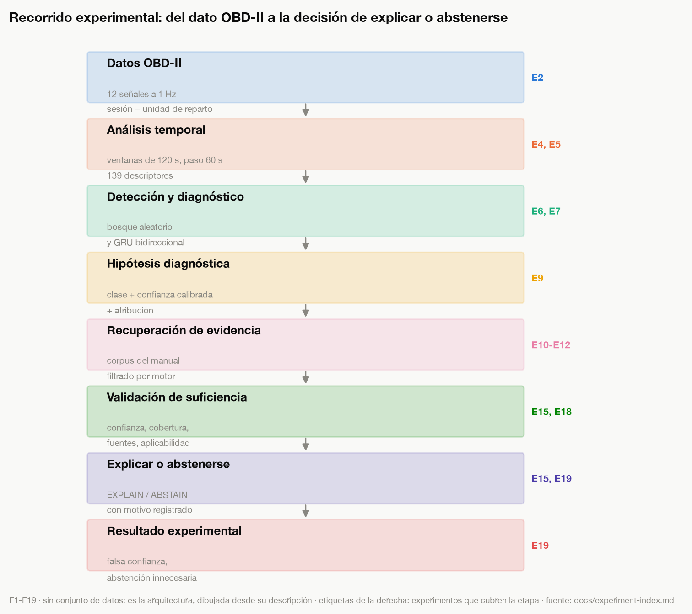
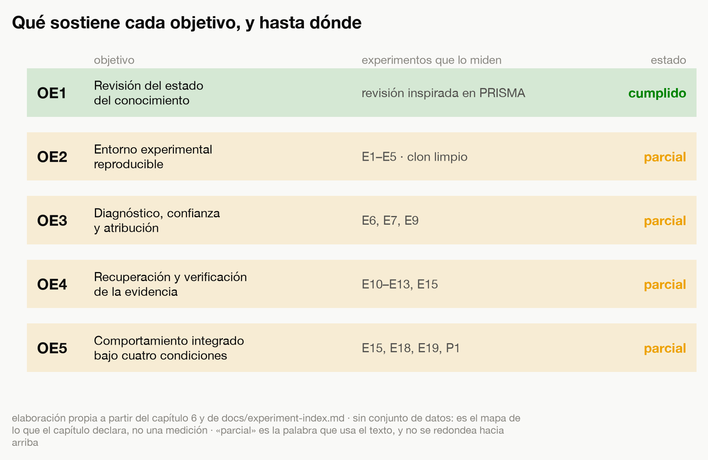
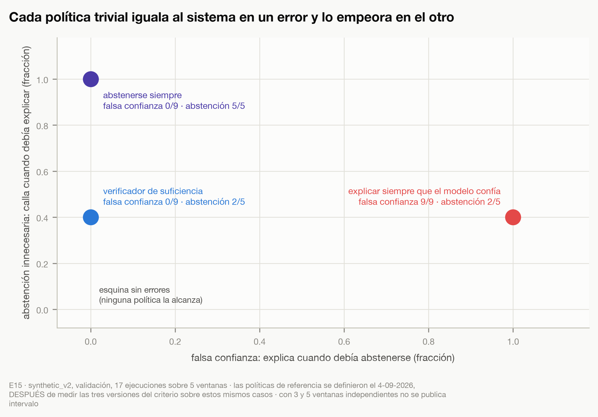

# Capítulo 6: Conclusiones

## Conclusiones provisionales sobre los objetivos y la pregunta de investigación

Esta es una entrega intermedia. Las conclusiones recorren los objetivos específicos en su orden y terminan en el general, y en cada uno separan lo que los resultados sobre validación permiten observar de lo que añade la evaluación final sobre el conjunto de prueba, **ejecutada el 12 de octubre de 2026 en el tercero de tres intentos**. El conjunto de prueba **no sigue cerrado**: se abrió cinco veces, y el anexo B recoge esas aperturas con su nivel de exposición. Las cifras de esa evaluación están incorporadas al capítulo 5 y se recogen aquí donde cambian lo que un objetivo puede afirmar.

> **Corrección del 13 de octubre de 2026.** Este párrafo decía antes: «de lo que requiere la evaluación final sobre el conjunto de prueba, que sigue cerrado». La evaluación final se ejecutó el 12 de octubre de 2026 y el conjunto se había abierto cinco veces. Corrección `F-2`.

Las conclusiones recorren un sistema con partes, y conviene tener delante cuáles son y qué
experimento mide cada una antes de decir hasta dónde llega cada objetivo. La Figura 6.1 las reúne.

**Figura 6.1. Recorrido experimental, del dato OBD-II a la decisión de explicar o abstenerse.**

*Fuente: elaboración propia. Experimento: ninguno en particular; las etiquetas de la derecha indican qué experimentos, de E1 a E19, cubren cada etapa. Sin conjunto de datos: es la arquitectura, dibujada desde su descripción, y por tanto una figura ilustrativa y no una medición. Protocolo: el esquema se dibuja desde el índice de experimentos y no desde ninguna ejecución. Artefacto: su correspondencia con el fichero, el guion que lo genera y el registro del que sale está en la tabla C.5 del anexo C.*

La figura separa lo que se observa, lo que el modelo infiere, lo que se recupera, lo que se verifica
y lo que se decide, y asigna a cada etapa los experimentos que la miden. Esa separación es la
decisión de diseño que este trabajo evalúa, y la figura la hace legible de un vistazo. Conviene, por
eso mismo, declarar lo que no aporta: dibuja el diseño, no su comportamiento, y que las etapas
aparezcan separadas en el esquema no implica que la separación produzca el resultado observado. Eso
último es justamente lo que las ablaciones **no** midieron, porque la separación entre decidir y
redactar no se ablacionó.

OE1, la revisión del estado del conocimiento, se cumplió en el alcance declarado. La revisión, inspirada en PRISMA pero sin su flujo formal, sin protocolo registrado y sin cribado por duplicado, delimitó el vacío en cuatro frentes y fundamentó las tres decisiones de diseño del capítulo 1; esos límites están declarados en el capítulo 3.

OE2, el entorno experimental reproducible, se cumplió parcialmente sobre telemetría sintética. El generador es determinista, los conjuntos se reparten por sesión, **el conjunto de prueba está cerrado en el código —pedirlo exige una autorización explícita y una razón por escrito, que queda registrada— y se abrió cinco veces bajo esa condición**, el corpus conserva su huella y el registro de la línea base de diagnóstico se reprodujo bit a bit. Las tres ejecuciones de las que salen las cifras publicadas —la línea base de diagnóstico, el modelo temporal y la evaluación final— se midieron sobre `synthetic_v2`, cuyas cuatro huellas se reconstruyeron bit a bit desde un clon limpio contra las que el manifiesto congeló antes de abrir el conjunto de prueba. Dos límites de la reproducibilidad que este objetivo declaraba de forma incompleta: **`synthetic_v3` no es reconstruible** con el generador publicado, porque es anterior a su calibración, y lo que lo hace peligroso es que su ventanado y su reparto sí reproducen, de modo que una reconstrucción ingenua pasaría las pruebas midiendo otras señales; de ese conjunto salen la comparación de volumen que el capítulo 5 discute y el conjunto de evaluación independiente del redactor, todavía sin ejecutar, y no las cifras publicadas. Y cuatro pruebas y seis comprobaciones de tipado dependían de dos paquetes que se importaban sin estar declarados, lo que solo se vio al validar el procedimiento desde un clon limpio.

> **Corrección del 13 de octubre de 2026.** Este párrafo decía antes: «el conjunto de prueba está cerrado por construcción». Confundía el cierre técnico, que sigue vigente, con el estado del conjunto, que no está cerrado. Corrección `F-3`. Este párrafo decía también: «`synthetic_v3`, **del que salen E6, E7 y la evaluación final**, no es reconstruible». Las tres ejecuciones declaran `synthetic_v2` en su registro, y `synthetic_v2` sí se reconstruye; el complemento «sobre `synthetic_v3`», que el registro de no reconstruibilidad sí lleva, se había perdido al resumirlo. Corrección `F-7`. No todas las ejecuciones son reproducibles con el mismo grado: los registros del modelo de diagnóstico y de la atribución son anteriores a la obligatoriedad del identificador de versión del código, y la medición translingüe no tiene registro de ejecución. La validación externa con telemetría de vehículos reales no forma parte de este objetivo y queda como limitación y prospectiva.

OE3, el diagnóstico a partir de la telemetría con la caracterización de su confianza y de sus señales, se cumplió parcialmente. Sobre validación, el bosque aleatorio alcanza una exactitud de 0,878 frente a 0,286 de la clase mayoritaria, y su confianza, infraconfiada en origen, queda calibrada, con un error de calibración que baja de 0,144 a 0,085. Con este volumen de datos el modelo temporal no aportó ventaja sobre el tabular, y la formulación original de la subpregunta, que la pedía, no se cumplió. La atribución describe con señales coherentes con el mecanismo la fuga de vacío, el termostato y la sonda; en la deriva del caudalímetro señala las correcciones de combustible y no el caudal, y en el fallo de encendido incluye entre sus seis señales principales cuatro que el mecanismo no justifica, aunque con menos peso que las declaradas. Dos de los errores del diagnóstico admiten una lectura más precisa desde la expresión efectiva del fallo: cinco de las catorce ventanas del termostato no contienen ninguna señal observable de él, y ninguna de las del fallo de encendido lo expresa por completo, de modo que parte de lo que el modelo no detecta es evidencia que no está.

OE4, la recuperación y la verificación de la evidencia, se cumplió parcialmente sobre los diecisiete casos anotados. Toda afirmación que el verificador admite conserva la observación que la origina y los fragmentos aplicables que superaron sus comprobaciones de soporte; si esas comprobaciones coinciden con un juicio independiente sobre lo que cada fragmento sostiene no se ha medido, porque el conjunto anotado no incluye las afirmaciones admisibles. Sin guía por código de avería, ninguna estrategia de recuperación encuentra el procedimiento relevante en todos los casos puntuados; guiada por el código asociado al diagnóstico, lo encuentra en los cinco, y ese resultado no cambió al corregir el índice documental y reejecutar. El modelo de lenguaje no cita nada que no se le haya entregado, pero cita fragmentos aplicables que el verificador no aceptó, y su adaptador se ajustó con ventanas que incluyen las de tres casos evaluados. Que las comprobaciones del verificador coincidan con lo que un fragmento sostiene de verdad no se ha medido de forma independiente.

OE5, el comportamiento integrado bajo las cuatro condiciones de evidencia, se cumplió parcialmente. Sobre las ejecuciones que debían terminar en abstención, nueve de tres ventanas bien diagnosticadas sin contar la condición con distractor y filtro, el sistema no explicó ninguna; una política que se abstuviera siempre obtendría el mismo cero, y lo que distingue al sistema es que, sobre los cinco casos con evidencia completa, explica tres. Las dos abstenciones innecesarias no tienen la misma causa: una procede solo de la confianza del modelo y la otra también de la falta de soporte documental. La abstención con evidencia retirada está determinada por la construcción de la condición; el contraste que pone a prueba el criterio es el de la evidencia parcial. El criterio que produce estas cifras se revisó dos veces sobre los mismos casos. La condición con distractor, con el filtro de motor activo, no añadía en ninguno de los tres fallos un distractor que la condición parcial no tuviera —la causa medida es que dos de las tres tenían la misma configuración que la parcial, no el filtro de motor— y **se rediseñó y se ejecutó el 13 de octubre de 2026**. Sobre el conjunto de prueba, con la política de suficiencia ya corregida, el comportamiento se mantiene: de las catorce ejecuciones que debían terminar en abstención el sistema no explicó ninguna, y de las ocho que debían terminar en explicación se abstuvo en dos, las mismas dos condiciones que fallaban en validación y por las mismas causas.

> **Corrección del 13 de octubre de 2026.** Este párrafo decía antes: «y necesita un rediseño antes de sostener sobre ella una inferencia». El rediseño se hizo y se ejecutó, y la causa del fallo anterior era otra. Corrección `F-5`.

Las ablaciones, ejecutadas el 1 de octubre de 2026, sitúan la contribución de cada componente. El criterio compuesto de suficiencia es el que sostiene el resultado, y lo que muestra es que una confianza diagnóstica alta no basta cuando la evidencia documental no sostiene la explicación: con una puerta de confianza sola el sistema explica las doce ejecuciones que debían terminar en abstención, y exigiendo solo que exista algún fragmento aplicable, seis de nueve. La atribución, en cambio, resultó sustituible por un criterio estadístico simple sin que cambiara ninguna decisión ni ningún conjunto de evidencia: no interviene en la política de abstención, y su contribución está en la trazabilidad y en la explicación de la predicción, que es una dimensión que este trabajo no ha evaluado. La ablación de la recuperación semántica quedó inconclusa, porque la ruta léxica no recupera nada con una consulta en prosa; su variante queda declarada como medición nueva y sin ejecutar.

La segunda versión de la política de suficiencia, medida en los tres modos, no cambia ninguna de las diecisiete decisiones y mejora el control de aplicabilidad ante un diagnóstico incorrecto: en el escenario adverso deja de aceptar como soporte afirmaciones construidas para un diagnóstico equivocado. Se adoptará como canónica en la evaluación final, de modo que los resultados anteriores quedan bajo la política previa y la evaluación final bajo la nueva, cada uno con su registro.

En cuanto al objetivo general, la evaluación experimental del agente está hecha en parte. Sobre datos sintéticos de un vehículo, sobre ventanas bien diagnosticadas y sobre la partición de validación, los resultados indican que las afirmaciones que el verificador admite mantienen una correspondencia registrada con la observación y los fragmentos que las sostienen, y que el agente se abstiene cuando la evidencia documental falta o no sostiene lo que se afirma, sin haber explicado ninguno de los casos evaluados en los que debía abstenerse. Esa respuesta parcial no alcanza tres cosas que la pregunta de investigación también contiene. No alcanza a la explicación que redacta el modelo de lenguaje, cuya correspondencia con la evidencia verificada es más débil. No alcanza al rechazo de evidencia aparentemente pertinente pero no aplicable, que el diseño actual no permite interpretar. Y no alcanza al comportamiento ante un diagnóstico erróneo, examinado solo en un escenario de dos ventanas anterior a la corrección del índice. Con la regla fijada en el capítulo 4, esa situación corresponde a una pregunta parcialmente sostenida, calificación provisional que descansa en cifras de desarrollo sobre validación. Lo que la evaluación final añade, medida el 12 de octubre de 2026 sobre el conjunto de prueba y con la política de suficiencia ya corregida, es que el comportamiento se mantiene fuera de los casos con que el criterio se ajustó: ninguna de las catorce ejecuciones que debían terminar en abstención terminó en explicación, y la cobertura con evidencia completa fue de seis sobre diez. Con esos denominadores, el intervalo de Wilson al 95 % de la falsa confianza va de 0 a 0,215, un límite que depende del nivel de confianza elegido y del modelo estadístico empleado, y que supone una independencia entre ejecuciones que estas no tienen. Lo medido es que en esa muestra no ocurrió, no que no pueda ocurrir; la distancia entre las dos frases es la que separa una observación de una garantía operativa, y este trabajo solo tiene lo primero. La contribución de los componentes ya está medida con las ablaciones. El rediseño de la condición con distractor no formaba parte de esa evaluación final y **se ejecutó aparte, el 13 de octubre de 2026**, con los cuatro requisitos de alcanzabilidad comprobados antes de observar ningún veredicto. En los tres casos construidos el sistema se abstuvo, y el motivo registrado fue la insuficiencia de la evidencia y no la falta de confianza en el diagnóstico: las confianzas, entre 0,908 y 1,000, estaban por encima del umbral. El distractor llegó al verificador clasificado como plenamente aplicable —del motor correcto y con el código del fallo—, de modo que ni el filtro de motor ni el validador de aplicabilidad intervinieron: lo que rechazó la evidencia fue la comprobación de que el fragmento hablara de la señal observada. Con tres situaciones construidas, el resultado describe esas tres y **no estima ninguna tasa**; PI.4 pasa de no tener respuesta interpretable a tener una medición acotada a sus casos. La calificación de parcialmente sostenida no se mueve por ello: P1 la refuerza en PI.4 y el hallazgo sobre la fidelidad numérica de las explicaciones la debilita en PI.2. La Figura 6.2 reúne los cinco objetivos específicos con la evidencia que los sostiene y el estado en que quedan.

> **Corrección del 13 de octubre de 2026.** Este párrafo decía antes: «queda como trabajo posterior: mientras no se haga, PI.4 seguirá sin poder interpretarse». El rediseño se ejecutó el 13 de octubre de 2026 con resultado publicado. Corrección `F-5`.

**Figura 6.2. Objetivos específicos, experimentos que los sostienen y estado de cumplimiento.**

*Fuente: elaboración propia a partir de este capítulo y del índice de experimentos. Experimento: ninguno en particular; cada fila nombra los que miden su objetivo. Sin conjunto de datos: es el mapa de lo que el propio capítulo declara, no una medición. Protocolo: el estado de cada fila es el que este capítulo afirma en prosa, sin redondear hacia arriba. Artefacto: su correspondencia con el fichero, el guion que lo genera y el registro del que sale está en la tabla C.5 del anexo C.*

Cuatro de los cinco objetivos quedan cumplidos parcialmente y uno, el de la revisión del estado del
conocimiento, cumplido en el alcance declarado. La figura permite ver de una vez qué experimento
sostiene cada objetivo, que es la cadena que un lector externo necesita recorrer para comprobar
cualquier afirmación de este capítulo. Lo que no debe leerse en ella es una medida de progreso: la
palabra «parcial» recoge situaciones distintas —un objetivo al que le falta validación externa, otro
al que le falta una medición independiente y otro cuya reproducibilidad tiene dos límites
declarados—, y la figura las iguala en una sola etiqueta. El detalle de cada una está en los
párrafos anteriores, y la figura no los sustituye.

## Contribuciones del trabajo

Las contribuciones se separan en tres planos, porque no tienen el mismo estatuto: lo construido, lo
medido y el procedimiento con que se midió. El orden importa, y el apartado termina diciendo bajo
qué condiciones dejan de ser válidas.

### Contribuciones técnicas

Lo que se ha construido y funciona, que es el plano más débil de los tres y conviene declararlo
primero. El trabajo implementa un recorrido de ocho etapas en el que la decisión de explicar o
abstenerse **no la toma el modelo de lenguaje** sino un verificador determinista, y en el que cada
afirmación conserva la observación de telemetría que la origina y los fragmentos documentales que
superaron sus comprobaciones. Sobre esa arquitectura se añaden tres piezas: un criterio de
suficiencia que combina confianza calibrada, aplicabilidad documental, número de fuentes y cobertura
de afirmaciones; un generador de telemetría sintética parametrizado contra el manual de taller del
vehículo, con cada constante trazada a su cita; y una barrera externa que rechaza cualquier
identificador documental que el modelo no haya recibido.

Ninguna de las tres piezas es nueva por separado, y combinarlas no es por sí mismo una aportación.
Lo que el trabajo puede decir de ellas es que funcionan y que están disponibles para reproducir sus
resultados; afirmar más exigiría una comparación contra una arquitectura alternativa que no se ha
hecho.

### Contribuciones experimentales

Lo que se ha medido y sostiene una afirmación. Son cuatro, y cada una lleva el alcance dentro.

**Tener documentación aplicable no equivale a tener soporte, y la diferencia es medible.** Con cinco,
seis y siete fragmentos del vehículo correcto y con el código de avería correcto delante, la
cobertura de afirmaciones del verificador es **0,00** en todos los casos de evidencia parcial y con
distractor. La ablación lo confirma desde el otro lado: retirando el criterio de suficiencia y
exigiendo solo que exista algún fragmento aplicable, el sistema explica **seis de las nueve**
ejecuciones que debían terminar en abstención. Es la observación que motiva la pregunta de
investigación, y es la que el trabajo mide con más claridad. Su alcance: diecisiete ejecuciones
sobre cinco ventanas de un vehículo, con datos sintéticos.

**Una decisión correcta no garantiza una explicación correcta.** El verificador decide bien y el
modelo de lenguaje que redacta esa decisión escribe cifras que no recibió: **siete de las treinta y
cinco salidas** de la evaluación final contienen al menos un número que el verificador no produjo, y
el peor caso escribe una comparación aritméticamente cierta con un valor y un umbral inventados, de
modo que nada dentro de la frase delata el error. Las tres barreras del sistema lo dejan pasar
porque comprueban que el identificador citado se hubiera entregado, **no que el número dicho sea
cierto**. Ninguna de las dos tasas de la evaluación cambia por ello. Es un hueco en la trazabilidad
que el trabajo no había declarado y que ahora declara.

**Existen límites de evidencia identificables por anticipado, y en ellos abstenerse es lo correcto.**
El termostato bloqueado impone un techo de temperatura; mientras el motor no habría superado ese
techo por sí mismo, la señal del motor averiado y la del sano son idénticas. Las cinco ventanas que
el modelo no detecta están todas por debajo de él. No es una limitación del modelo sino de la
evidencia disponible, y la distinción entre llevar la etiqueta de un fallo y contener señal
observable de él lo generaliza a las demás condiciones.

**Lo que protege frente a evidencia aparentemente pertinente no es la aplicabilidad.** Un fragmento
del motor correcto y con el código del fallo supera entera la comprobación de aplicabilidad; lo que
lo rechaza es exigir que hable de la señal observada. Alcance: tres casos construidos, seis
ejecuciones, sin estimación de tasa.

### Contribución metodológica, complementaria y acotada

Se enuncia aparte y después porque no responde a la pregunta de investigación, y con el alcance que
la evidencia aguanta:

> Un procedimiento para sostener de forma verificable, y a coste casi nulo, que las decisiones de
> diseño de un experimento no se modificaron entre la primera exposición al conjunto reservado y la
> medición, junto con un registro graduado de esas exposiciones en cinco niveles. Pensado para el
> caso de un solo operador con asistencia de agentes, donde no hay separación de funciones que
> garantice nada. Su valor demostrado es la **detección y el registro honesto**, **no la
> prevención**.

Lo que detectó, con fecha: la contaminación del conjunto de ajuste del modelo de lenguaje, cuyos
ejemplos salían de la partición donde se le medía; cuatro artefactos sobrescritos al probar una
comprobación; una tabla publicada borrada sin copia; una apertura accidental del conjunto de prueba;
un diagnóstico equivocado de la causa del fallo de la condición con distractor; y la causa del fallo
del reentrenamiento. Seis casos en seis semanas.

Lo que **no** evitó, que es la parte que obliga a la prudencia: la contaminación existía desde el 2
de septiembre y tardó **seis semanas** en detectarse; el diagnóstico equivocado de la condición con
distractor estuvo publicado **cinco semanas**; la apertura accidental se detectó después de
producirse; los cuatro artefactos ya estaban sobrescritos cuando el censo lo advirtió; y la tabla
borrada es **irreversible**.

De las seis piezas del procedimiento, **cinco son aplicación correcta de práctica conocida** —el
pre-registro, las huellas criptográficas, la comprobación de disyunción entre particiones, el
registro de incidencias y la verificación en un gate de calidad—, y presentarlas de otro modo sería
insostenible. No hay comparación contra su ausencia, no hay más de un caso, no hay coste medido y no
hay evidencia de que sea transferible a un equipo.

### Limitaciones de las contribuciones

Las cuatro contribuciones experimentales dejan de ser válidas fuera de las condiciones en que se
obtuvieron, y conviene nombrarlas juntas. Todas proceden de **un vehículo**, de **telemetría
sintética** y de un **catálogo cerrado de cinco fallos**. Las unidades independientes son pocas: tres
y cinco ventanas en validación, siete y ocho en prueba, tres casos en el rediseño del distractor.
El criterio que produce las cifras de decisión **se revisó dos veces sobre los mismos casos con los
que se evalúa**, y el modelo de lenguaje se ajustó con ventanas que incluyen las de tres de los
casos en que se le mide. Las ventanas evaluadas son ventanas que el modelo diagnostica
correctamente, de modo que las tasas describen el comportamiento del agente **cuando el diagnóstico
de partida es acertado** y deben leerse como cota superior.

Tres cosas que el trabajo **no** ha demostrado y que conviene no dar por supuestas. No ha demostrado
que el sistema detecte averías ajenas a su catálogo: no lo intenta. No ha demostrado que la
correspondencia entre una afirmación y su evidencia coincida con el juicio de un experto, porque el
conjunto anotado no incluye qué afirmaciones serían admisibles: la trazabilidad se cumple **por
construcción y no por medición**. Y no ha demostrado que el comportamiento observado se deba a
separar la decisión de la redacción: esa separación no se ablacionó, y lo medido es el
comportamiento de un sistema que la implementa.

## Limitaciones

La interpretación de los resultados está condicionada, en primer lugar, por la procedencia de los datos. La evaluación utiliza telemetría OBD-II sintética, lo que permite controlar las condiciones representadas y reproducir los experimentos, pero no incorpora toda la variabilidad presente en un vehículo en operación. Factores como el desgaste de los componentes, las condiciones ambientales, las diferencias entre conductores, el ruido de los sensores y la interacción entre fallos quedan fuera del entorno experimental actual.

El estudio utiliza un único vehículo de referencia, un Mazda 3 BK de 2007 con motor Z6. Esta decisión permite mantener coherencia entre la configuración mecánica representada, los códigos de avería y la documentación técnica utilizada, pero limita la generalización de los resultados a otros vehículos, generaciones, motores y fabricantes.

El modelo de diagnóstico trabaja sobre un catálogo cerrado de clases de fallo, de modo que el trabajo no examina el comportamiento del sistema ante averías ajenas a ese catálogo; esa extensión queda fuera del alcance y se recoge entre las líneas futuras.

El número de casos anotados y la utilización de diferentes variantes documentales sobre una misma ventana de telemetría limitan el tamaño efectivo de la muestra. Las ejecuciones realizadas sobre una misma ventana se consideran medidas relacionadas y no observaciones independientes, por lo que el análisis se plantea principalmente de forma comparativa y por casos.

Los diecisiete casos del agente se construyeron sobre ventanas que el modelo clasifica correctamente, y las anotaciones y consultas se redactaron conociendo el fallo de cada caso. Las tasas de decisión describen, por eso, el comportamiento del agente cuando el diagnóstico de partida es acertado, y deben leerse como cota superior; el comportamiento ante un diagnóstico erróneo solo se ha observado en un escenario adverso de dos ventanas, registrado antes de corregir el índice documental.

El precio de esa falsa confianza nula se aprecia mejor enfrentando al sistema con las dos políticas
triviales que lo rodean, que es lo que hace la Figura 6.3.

**Figura 6.3. Los dos errores del sistema y los de las dos políticas triviales, sobre los mismos casos.**

*Fuente: elaboración propia. Experimento: E15. Conjunto: `synthetic_v2`, validación, 17 ejecuciones sobre 5 ventanas. Protocolo: las dos políticas de referencia se definieron el 4 de septiembre de 2026, después de medir las tres versiones del criterio sobre estos mismos casos, y se calculan sobre ellos. Artefacto: su correspondencia con el fichero, el guion que lo genera y el registro del que sale está en la tabla C.5 del anexo C.*

El plano hace explícito el compromiso que las tasas sueltas esconden. Abstenerse siempre consigue la
falsa confianza nula y pierde las cinco oportunidades de explicar; explicar siempre que el modelo
confía conserva la cobertura y comete los nueve errores del otro tipo. Cada política trivial iguala
al sistema en uno de los dos errores y lo empeora en el otro, y ninguna de las tres alcanza la
esquina sin errores. Lo que esto permite concluir es que el valor del criterio de suficiencia no
está en ninguna de las dos cifras por separado, sino en sostener las dos a la vez sobre los mismos
casos. Dos limitaciones conviene repetirlas aquí: las políticas de referencia se definieron después
de ver los resultados del criterio, lo que las hace un punto de comparación informativo y no una
línea base independiente; y los denominadores son de tres y cinco ventanas, de modo que el plano
describe esta muestra y no estima ninguna frontera.

El criterio de suficiencia se revisó dos veces sobre los mismos casos con los que se evalúa, el umbral de confianza se enmendó después de ver el primer barrido y las subpreguntas se reescribieron con los primeros resultados ya obtenidos. Las cifras de decisión son, por tanto, las de un criterio ajustado a esta muestra, y la evaluación sobre el conjunto de prueba es la que puede medir si se mantienen. Las ablaciones ejecutadas atribuyen el comportamiento al criterio de suficiencia, no a la separación entre decidir y redactar: esa separación no se ablaciona, y sigue sin compararse con una abstención decidida por el propio modelo de lenguaje.

El índice documental mezcló hasta el 4 de septiembre de 2026 dos espacios vectoriales. La recuperación, la suficiencia y la redacción se reejecutaron tras corregirlo, sin cambios en las decisiones; el adaptador del modelo de lenguaje, en cambio, sigue entrenado sobre ejemplos generados antes de la corrección, con ventanas que incluyen las de tres casos evaluados, dos en entrenamiento y una en validación, y no se ha reentrenado.

La condición con distractor, con el filtro de motor activo, no manipulaba la variable que pretendía manipular. Su rediseño se ejecutó el 13 de octubre de 2026 y da a la subpregunta sobre el rechazo de evidencia no aplicable una respuesta acotada a tres casos construidos, que no estima ninguna tasa. Y la fidelidad numérica del texto que redacta el modelo de lenguaje no está garantizada: en la evaluación final, siete de sus treinta y cinco salidas contienen al menos una cifra que el verificador no produjo, sin que ninguna de las dos tasas cambie por ello, porque las produce el verificador determinista.

## Prospectiva

La continuación más clara es evaluar el sistema con telemetría OBD-II tomada de vehículos reales, porque solo así puede verse si el comportamiento observado sobre datos sintéticos aguanta la variabilidad de la operación: conductores distintos, condiciones ambientales cambiantes, componentes desgastados, ruido de sensores y fallos que aparecen a la vez.

Conviene hacerlo sobre el vehículo de referencia, o sobre otro cuya documentación técnica tenga suficiente detalle para que telemetría, configuración mecánica y evidencia documental sigan correspondiéndose. El entorno experimental admite cambiar la fuente de telemetría sin tocar la lógica de recuperación, verificación y decisión, aunque cada fuente nueva obliga a revisar la parametrización, la segmentación temporal y la aplicabilidad de la documentación.

Vendrían después otros vehículos, otros motores y otros fabricantes: el trabajo se apoya hoy en una sola configuración mecánica, y ampliarla mostraría si la recuperación y la validación siguen funcionando cuando la documentación cambia de estructura, de nomenclatura, de códigos de avería y de procedimientos.

El diagnóstico se apoya en un catálogo cerrado de cinco fallos. Examinar qué hace el sistema ante una avería ajena a ese catálogo, cuando el modelo de diagnóstico no dispone de la clase correcta y la confianza puede no advertirlo, es una línea distinta de la que esta memoria evalúa y se deja para después.

Hace falta también ampliar los casos anotados y hacerlos más difíciles: fallos simultáneos, evidencia que se contradice en parte, documentación que parece pertinente pero corresponde a otra configuración, construida de modo que la condición con evidencia parcial no la contenga ya, y situaciones en las que más de una hipótesis encaja con la misma telemetría. Ese último caso es el que menos se ha explorado y el que más dice sobre cuándo el sistema debería abstenerse en lugar de elegir.

El despliegue sobre una plataforma embarcada abre otra línea, que permitiría medir latencia, consumo de recursos, funcionamiento sin conexión y operación continua sobre telemetría tomada directamente del vehículo. Llega después, porque lo que ahora está en juego es el proceso diagnóstico y no sus condiciones de ejecución.

Queda abierta, por último, la posibilidad de conservar las explicaciones que superaron la validación para reutilizarlas en casos posteriores. Eso plantea preguntas propias: cómo se recupera una explicación validada cuando reaparece un caso equivalente, qué hacer cuando surge evidencia que la contradice, y qué impide que algo aceptado para un vehículo y unas condiciones concretas acabe aplicándose donde no corresponde. También exigiría una salvaguarda contra la circularidad, para que una explicación conservada no se convierta en evidencia de sí misma.

## Consideraciones finales

Una explicación plausible y una explicación sostenida por evidencia se parecen mucho sobre el papel, y en diagnóstico las dos pueden producir un texto igualmente convincente. Solo una permite dar una hipótesis por validada.

De ahí que la arquitectura mantenga separados lo que se observa, lo que el modelo infiere, lo que se recupera, lo que se verifica y lo que se decide, porque encontrar un fragmento no es tener evidencia y una referencia puede existir, estar bien citada y no sostener aquello para lo que se usa. Cuando la evidencia falta, que un modelo sepa redactar una respuesta no la suple.

Queda por determinar hasta dónde llega esa separación cuando se recorre el proceso completo que plantea la pregunta; mientras tanto, las conclusiones no pueden ir más allá de lo que los experimentos hayan mostrado.
